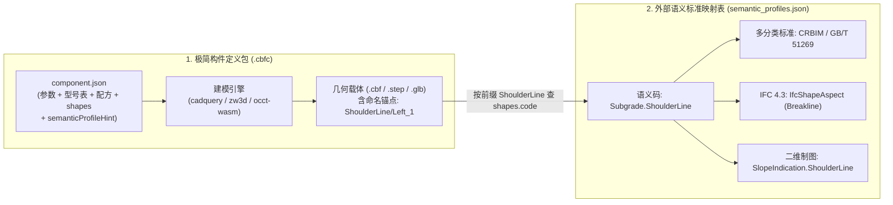

# CBF-C 构件数据格式与工程落地规范 v1.3.2（极简构件模板 + 外部语义映射架构版）

- **版本**：1.3.2 (Refactored Clean Architecture & Verified Baseline)
- **状态**：正式标准基线（Approved Specification Baseline）
- **日期**：2026-10-18
- **前序版本**：[v1.0](file:///D:/QtOCCTApp/docs/cbf_c_component_format_spec_v1.0.md) | [v1.1](file:///D:/QtOCCTApp/docs/cbf_c_component_format_spec_v1.1.md) | [v1.2](file:///D:/QtOCCTApp/docs/cbf_c_component_format_spec_v1.2.md) | [v1.3](file:///D:/QtOCCTApp/docs/cbf_c_component_format_spec_v1.3.md) | [v1.3.1](file:///D:/QtOCCTApp/docs/cbf_c_component_format_spec_v1.3.1.md)
- **设计借鉴**：融合 **Autodesk Civil 3D (`.pkt` 点/线/面语义编码 `Code Set`)**、**Archicad GDL (`.gsm` 脚本逻辑内聚)**、**Autodesk Revit (`Subcategory` + 外部 `IFC Mapping Table` + `Type Catalog`)** 及 **Pixar OpenUSD (按需叠加 Schema)** 的成熟工业架构。

---

## 0. v1.3.2 架构设计核心说明（三大减法重构与严密性闭环）

针对早期版本将“几何参数定义”与“IFC 导出语法、多套国标分类码、算量公式、二维制图规则”全部混塞进单个 `component.json` 导致的膨胀问题，本规范对标了工业界 5 款同类成熟产品的核心架构：

| 成熟产品 / 格式 | 适用领域 | 容器与核心结构 | 处理“参数、多规格、局部几何语义与标准映射”的核心机制 |
| :--- | :--- | :--- | :--- |
| **1. Autodesk Civil 3D**<br>Subassembly Composer (`.pkt`)<br>⭐ **最直接对标** | 铁路、公路路基、边坡、挡墙、隧道、排水沟 | **ZIP 包**（内含工作流定义、参数表、预览图） | **P/L/S Codes（点/线/面语义编码）**：<br>构件只负责给点打上 `"Shoulder"` / `"Toe"`、给线打上 `"Slope"`、给闭合区打上 `"Subgrade"`。**构件包内完全不写死任何 IFC、国标分类码或二维示坡线样式**，全部由宿主软件外部的 **Code Set Style（编码样式与映射表）** 统一关联。 |
| **2. Archicad GDL**<br>(`.gsm` 构件包)<br>⭐ **脚本建模鼻祖** | 参数化建筑/结构/机电构件（与 Python 脚本建模最像） | **二进制/ZIP 包**（仅含：参数表 + 脚本 + 预览图） | **逻辑内聚于脚本，清单极度纯粹**：<br>清单只声明纯粹的参数列表；派生公式（`derived`）、参数合法性校验（`constraints`）、端口计算全部写在建模脚本内部，不在外部 JSON 中重复发明一套复杂的表达式语法。 |
| **3. Autodesk Revit**<br>Family (`.rfa` + `.txt` Type Catalog) | 建筑、桥梁、通用 BIM 构件族 | 原生几何包 + **CSV 类型目录表** | **“子类别（Subcategory）”与外部 IFC 映射表分离**：<br>构件内的面/线只挂一个轻量的 `Subcategory` 名字（如 `"SlopeFace"`）；导出什么 `IfcClass`、挂什么分类码，由项目级的 **IFC Export Mapping Table** 集中配置。多预定义规格（Presets）则用扁平表格存储。 |
| **4. Bentley OpenRail**<br>Parametric Cell (`.cel` / `.paz`) | 铁路轨道、桥梁、站房、市政 | 单元库 + 变量表（Variations） | **特征命名（Named Features）+ 外部特征定义库（Feature Definitions）**：<br>建模引擎只输出带名字的几何（如 `"ShoulderLine"`）；材质、算量规则、分类编码全部写在外部公共的 `Feature Definition` 库中，通过名字自动关联。 |
| **5. Pixar OpenUSD**<br>(`.usdc` / `.usdz`) | 现代工业数字孪生与跨平台三维资产 | 分层组合（Layers & Schemas） | **按需挂载 Schema（用不到的特性零开销）**：<br>基础几何资产极度轻量；物理属性、BIM 语义作为独立 Layer 按需叠加，不强迫所有构件写满大而全的字段。 |

### 0.1 三大减法重构原则

1. **借鉴 Civil 3D `Code Set` 与 Revit `Subcategory`：将“行业标准映射”从构件包中彻底剥离至外部《语义标准映射表》**
   - **构件包（`component.json`）只贴语义码（Semantic Code）并提供映射表提示（`semanticProfileHint`）**：构件内的几何部位（`shapes`）只声明一个轻量的语义编码 `code`（例如 `"Subgrade.SlopeBody"`、`"Subgrade.SlopeFace"`、`"Subgrade.ShoulderLine"`、`"Subgrade.ToeLine"`），不再在每个构件包里重复书写 `CRBIM` / `GB/T 51269` 分类码、`IfcShapeAspect` 语法或 `Qto_*` 算量绑定。
   - **系统级/项目级《语义标准映射表》（`semantic_profiles.json`）集中管理标准映射**：所有与行业分类编码标准、IFC 4.3 导出实体、标准算量集（`Qto_*`）及二维制图样式（如示坡线角色 `SlopeIndication`）相关的映射规则，统一抽离到宿主系统的公共配置文件 `semantic_profiles.json` 中。**切换行业标准（如铁路标准切换为公路标准）只需切换外部映射表，成千上万个 `.cbfc` 构件包无需改动一行！**
2. **借鉴 Archicad GDL：计算逻辑内聚于建模引擎，废除 JSON 表达式造轮子**
   - 彻底移除 `component.json` 中的前端公式求值（`derived.expr`）、复杂约束表达式（`constraints.expr`）及连接端口坐标公式。
   - 所有派生参数计算、参数合法性校验、曲线自适应连接端口坐标（`anchors`）统一由建模引擎内部计算并通过 JHB 协议返回，`component.json` 回归纯粹的静态数据结构。
3. **借鉴 Revit `Type Catalog`：扁平化预定义规格表（`presets`）与 `<shapeKey>/<instanceTag>` 多实例机制**
   - `parameters.presets` 采用紧凑的扁平键值字典，支持同一族模板衍生任意多个标准图集型号；
   - 建模引擎输出支持 `<shapeKey>/<instanceTag>`（如 `"ShoulderLine/Left_1"`、`"ToeLine/Left_1"`），前缀查 `shapes` 获取语义码 `code`，后缀自动实现左右/多级边坡特征线的同名配对。

### 0.2 v1.3.2 相对 v1.3 / v1.3.1 的严密性增量修正（保持极简前提下的 10 项加固）

1. **预烘焙几何缓存绑定（`geometry.defaultCacheKey`）**：在 `geometry` 节仅增加 1 行 `defaultCacheKey`，规定其必须等于默认参数（经默认 `ModelNumber` 规格展开后）计算的 `cacheKey`，杜绝 `default.cbf` 与默认参数不同步。
2. **二元组能力推导真值表**：保持 `geometry` 仅声明 `exactBrep` 1 个布尔值，明确 `(identity.sourceMode, geometry.exactBrep)` 到运行时能力（变参、布尔、精确测量）的唯一推导矩阵，禁止 `mesh-only` 声明 `exactBrep: true`。
3. **紧凑型默认端口快照字典（`ports`）**：将 `ports` 定义为紧凑键值字典（记录默认参数下的初始静态坐标系，引擎运行后由 JHB `anchors` 动态覆盖），兼顾免脚本轻量预览与曲线动态放样。
4. **`CacheKeyPayload` 外部几何参数闭环与 `DeterministicJSON` 测试向量**：补齐 `inputParams` 中可选外部几何（未传时固定为 `null`，传入时为内容 SHA-256），定义 5 条无歧义的 `%.12g` + UTF-8 原生直出确定性序列化规则并附 3 条数学验证测试向量。
5. **`semantic_profiles.json` 的 IFC 4.3 `IfcShapeAspect` 标准属性修正与算量动态单位换算**：移除 `IfcShapeAspect` 在 IFC 4.3 中不存在的 `predefinedType`/`curveType` 属性，改为标准的 `description` + `representation{identifier, type}` 结构；顶层新增 `quantityUnits`（`m`/`m2`/`m3`），按两侧单位动态计算换算因子 $(u_{\text{source}} / u_{\text{target}})^n$。
6. **XCAF `AddSubShape` 注册与 $O(1)$ 子形状包围盒防错位恢复校验**：明确附录 A.2 使用 `XCAFDoc_ShapeTool::AddSubShape` 注册子形状，附录 A.3 采用 $O(1)$ 子形状数量、`TopAbs_ShapeEnum` 类型与生成期 `bbox` 包围盒校验，杜绝同类型子形状错位。

---

# 第一部分：通用构件数据格式标准正文（Normative Specification）

## 1. 核心架构：构件定义包与外部语义映射表双层解耦



### 1.1 文件与容器家族定义

| 载体名称 | 扩展名 / 格式 | 定位与职责 |
| :--- | :--- | :--- |
| **构件定义包** | **`.cbfc`** (ZIP) | **构件库中的“族模板”**。文件名为 `<familyId>_<revision>.cbfc`（同一构件库内 `familyId` 唯一且满足 `^[A-Za-z0-9_-]+$`）。内含极简清单 `component.json`、预览网格 `display/preview.glb`、可选预烘焙几何 `geometry/default.*` 及校验清单 `checksums.json`。 |
| **外部语义标准映射表** | **`semantic_profiles.json`** | **宿主系统/项目级公共配置（Code Set Style）**。定义各语义码（`code`）到国标/行标分类编码、IFC 4.3 实体与算量集、二维制图角色及标准物理材质库的映射规则。 |
| **几何缓存制品** | **`.cbf` / `.step` / `.glb`** | **运行时按 `<cacheKey>` 寻址的几何快照**。存储精确 BRep 或网格，并在子形状上携带 `<shapeKey>[/<instanceTag>]` 命名锚点。 |
| **项目交付包** | **`.rde`** (ZIP) | **工程项目容器**。存储主模型树（实例引用 + 型号选择/参数覆盖 + 空间布置）、当前项目绑定的 `semantic_profiles.json` 快照、二维工程图纸及去重几何缓存池（`geometry/<cacheKey>.*`）。 |

---

## 2. `.cbfc` 构件定义包物理结构

每个 `.cbfc` 为标准 Deflate ZIP 归档包（UTF-8 文件名编码），内部结构极简固定：

```text
<familyId>_<revision>.cbfc (ZIP 容器)
├── component.json          # [必须] 极简权威清单（身份、参数表、规格型号、建模配方、命名几何槽位）
├── geometry/               # [可选] 默认参数下的预烘焙几何制品（支持多格式并存）
│   ├── default.cbf         #        OCCT BinXCAF 原生精确几何（与 defaultCacheKey 严格同源）
│   ├── default.step        #        STEP AP242 跨内核标准精确几何
│   └── default.glb         #        仅当 sourceMode == "mesh-only" 时作为权威工程网格
├── display/                # [必须] 构件库预览与二维制图图例
│   ├── preview.glb         # [必须] 构件库卡片轻量预览网格（LOD 展示用途）
│   └── thumbnail.png       # [可选] 256x256 构件库卡片缩略图
├── generators/             # [可选] 仅当内嵌脚本或 WASM 模块时存在
│   └── subgrade_slope.py
└── checksums.json          # [必须] 包内除自身外所有文件的 SHA-256 校验清单
```

> **完整性与解压安全约束**：
> 1. 解压时拒绝任何含 `..`、前导 `/`、`\`、盘符 `:` 或符号链接的条目；
> 2. `checksums.json` 必须覆盖包内除自身外的**全部条目**，且包内**禁止存在未在 `checksums.json` 中登记的额外文件**（防止夹带未知载荷；`checksums.json` 用于完整性校验，分发防篡改依赖传输层 TLS 或外置数字签名）。

---

## 3. 极简 `component.json` 规范（构件包内部清单）

### 3.1 完整示例（以目标规范示例构件“路基边坡 `SubgradeSlope`”为例）

> **注**：当前项目代码库中既有 CadQuery 脚本位于仓库根目录 [`cq_script/`](file:///D:/QtOCCTApp/cq_script)（由 [`scripts-service/main.py`](file:///D:/QtOCCTApp/scripts-service/main.py#L224) 解析 `"service://<ModelType>"` 为 `<repo>/cq_script/<ModelType>.py`，现有脚本包括 [`Pile.py`](file:///D:/QtOCCTApp/cq_script/Pile.py)、[`PierBody.py`](file:///D:/QtOCCTApp/cq_script/PierBody.py)、[`PierTray.py`](file:///D:/QtOCCTApp/cq_script/PierTray.py)、[`BridgePier2.py`](file:///D:/QtOCCTApp/cq_script/BridgePier2.py)、[`Girder.py`](file:///D:/QtOCCTApp/cq_script/Girder.py)、[`PileCap.py`](file:///D:/QtOCCTApp/cq_script/PileCap.py) 等）。下文以路基边坡 `SubgradeSlope`（规划新增脚本 `subgrade_slope.py`）为完整示例，展示如何完整串联多规格型号、`<shapeKey>/<instanceTag>` 多子形状输出与 [`adSlopeIndication`](file:///D:/QtOCCTApp/core-data-model/schema/core-data-model.yaml#L137-L148) 二维示坡线闭环。

```json
{
  "format": "cbf-component",
  "schemaVersion": "1.3.2",

  "identity": {
    "componentId": "0199f3c2-7d5a-7c3e-9b1a-2f4d6e8a0b11",
    "familyId": "SubgradeSlope",
    "revision": "1.0.0",
    "name": "路基边坡",
    "category": "Subgrade",
    "semanticCode": "Subgrade.Slope",
    "semanticProfileHint": "Railway-CRBIM-IFC4X3@1.3",
    "sourceMode": "parametric",
    "placement": {
      "modes": ["point", "curve"],
      "orientation": "normalToCurve"
    }
  },

  "environment": {
    "units": { "length": "mm", "angle": "rad" },
    "tolerance": { "linear": 0.01, "angular": 0.001 }
  },

  "parameters": {
    "schema": [
      { "name": "ModelNumber",   "label": "标准型号",       "type": "enum",    "default": "STD-8M", "options": ["CUSTOM", "STD-8M", "STD-12M-2TIER"] },
      { "name": "Length",        "label": "边坡长度",       "type": "real",    "default": 20000.0,  "unit": "mm", "min": 2000.0, "max": 200000.0 },
      { "name": "Height",        "label": "首级边坡高度",   "type": "real",    "default": 8000.0,   "unit": "mm", "min": 100.0,  "access": "inout" },
      { "name": "SlopeRatio",    "label": "首级坡率(1:m)",  "type": "real",    "default": 1.5,      "unit": "1",  "min": 0.1,    "access": "inout" },
      { "name": "Tiers",         "label": "附加分级表",     "type": "table",   "default": [],       "access": "inout", "columns": ["tierHeight", "tierRatio", "bermWidth"] },
      { "name": "Alignment",     "label": "布置基准曲线",   "type": "curve3d", "optional": true },
      { "name": "GroundSurface", "label": "目标刷坡地形面", "type": "surface", "optional": true },
      { "name": "SlopeArea",     "label": "坡面总斜面积",   "type": "real",    "default": 288444102.037, "unit": "mm2", "access": "out" },
      { "name": "StrengthGrade", "label": "混凝土强度等级", "type": "enum",    "default": "C30",    "options": ["C25", "C30", "C35", "C40"] }
    ],
    "presets": {
      "STD-8M": {
        "label": "8米标准一级边坡",
        "drawingCode": "通线-2101-08",
        "Height": 8000.0,
        "SlopeRatio": 1.5,
        "Tiers": []
      },
      "STD-12M-2TIER": {
        "label": "12米标准二级带平台边坡",
        "drawingCode": "通线-2101-12",
        "Height": 8000.0,
        "SlopeRatio": 1.5,
        "Tiers": [{ "tierHeight": 4000.0, "tierRatio": 1.75, "bermWidth": 2000.0 }]
      }
    }
  },

  "recipe": {
    "engine": "cadquery",
    "source": "service://subgrade_slope",
    "entry": "build",
    "version": "1.0.0",
    "digest": "e3b0c44298fc1c149afbf4c8996fb92427ae41e4649b934ca495991b7852b855",
    "inputs": ["Length", "Height", "SlopeRatio", "Tiers", "Alignment", "GroundSurface"]
  },

  "geometry": {
    "exactBrep": true,
    "defaultCacheKey": "0fee26374b7a518d8098da4ad6c1ad52716d9f33f5bf183fe0f75f90f4bafac0",
    "defaultFile": "geometry/default.cbf",
    "defaultFormat": "cbf-binxcaf",
    "previewFile": "display/preview.glb"
  },

  "shapes": {
    "Body":         { "label": "边坡本体",   "geomType": "solid", "code": "Subgrade.SlopeBody",    "material": "Concrete" },
    "SlopeFace":    { "label": "路基边坡面", "geomType": "face",  "code": "Subgrade.SlopeFace",    "cardinality": "1..*" },
    "ShoulderLine": { "label": "路肩特征线", "geomType": "wire",  "code": "Subgrade.ShoulderLine", "cardinality": "1..*" },
    "ToeLine":      { "label": "坡脚特征线", "geomType": "wire",  "code": "Subgrade.ToeLine",      "cardinality": "1..*" }
  },

  "ports": {
    "StartSection": { "origin": [0.0, 0.0, 0.0],     "axis": [0.0, 0.0, 1.0], "refDirection": [1.0, 0.0, 0.0] },
    "EndSection":   { "origin": [20000.0, 0.0, 0.0], "axis": [0.0, 0.0, 1.0], "refDirection": [1.0, 0.0, 0.0] }
  }
}
```

> [!IMPORTANT]
> **外部语义映射表提示（External Semantic Mapping Table Prompt）**：
> 1. **为什么 `component.json` 中没有直接写 IFC 实体名、国标分类编码和二维制图样式？**
>    本规范借鉴 Civil 3D `Code Set Style` 与 Revit `IFC Export Mapping Table`，将易随行业/项目标准变化的映射规则剥离至外部的 **《语义标准映射表》（`semantic_profiles.json`，详见第 4.3 节）**。`component.json` 只需通过 `identity.semanticCode`（构件级）与 `shapes.<Key>.code`（几何部位级）声明稳定的语义码（格式满足 `^[A-Z][A-Za-z0-9]*(\.[A-Z][A-Za-z0-9]*)+$`，如 `"Subgrade.ShoulderLine"`），并通过 `identity.semanticProfileHint` 提示默认推荐的外部映射表 ID 及主次版本（如 `"Railway-CRBIM-IFC4X3@1.3"`，仅锁定 `major.minor`，补丁版本如 `1.3.1` 自动兼容）。
> 2. **外部语义映射表的三级解析优先级与覆盖规则**：
>    - **优先级 1（构件内按需局部覆盖）**：若极少数非标构件在 `shapes.<Key>` 下直接书写了 `classifications` 或 `ifc` 字段，采用**整字段直接替换（Replace）**策略优先使用构件内定义；
>    - **优先级 2（当前工程项目激活的外部映射表）**：宿主工程（`.rde` 项目配置）当前启用的 `semantic_profiles.json`（例如在铁路项目中激活 `"Railway-CRBIM-IFC4X3@1.3"`，在公路项目中一键切换为 `"Highway-JTG-IFC4X3@1.3"`，无需修改任何 `.cbfc` 构件包）；
>    - **优先级 3（`identity.semanticProfileHint` 默认回退）**：当脱离工程项目独立预览或导出单个 `.cbfc` 构件时，宿主系统自动加载 `semanticProfileHint` 指向的内置语义映射表。若某 `code` 在映射表中未找到，导出报告将其标记为 `unmapped` 并保留基础几何。

### 3.2 核心字段设计规范

#### （1）参数类型与访问级别（`parameters.schema`）
- **支持的数据类型（`type`）**：
  - **标量类型**：`real`、`integer`、`boolean`、`string`、`enum`；
  - **复合表格/数组类型**：`table`（行元素为按 `columns` 键名对应的 JSON 对象数组，如 `Tiers`）、`array`；
  - **外部空间几何输入类型**：`curve3d`（三维路线中心线）、`profile2d`（二维横断面）、`surface`（目标刷坡地形曲面 DTM）。当声明 `"optional": true` 且实例未传入时，其值固定为 `null`。
- **访问级别（`access`，默认省略时为 `"input"`）**：
  - `"input"`：纯输入参数（如 `Length`）；
  - `"inout"`：由 `presets` 规格型号表联动赋值、且允许用户手动微调覆盖的参数（如 `Height`、`SlopeRatio`）；
  - `"out"`：由建模引擎求值后通过 JHB `args` 回写的只读计算结果参数（如 `SlopeArea`）。
- **四步极简参数求值顺序**：
  1. 读取 `schema[*].default` 默认值；
  2. 若 `ModelNumber` 命中 `presets[ModelNumber]`，将其中的参数键值覆盖至对应参数；
  3. 应用工程实例的 `parameterOverrides`；
  4. 提取 `recipe.inputs` 中列出的参数计算 `cacheKey`，未命中缓存则调用建模引擎并将返回的 `args` 按 `%.17g` 无损回写至 `out` / `inout` 参数。
- **连接端口（`ports`）**：`component.json` 中的 `ports` 字典记录默认参数（对应 `geometry.defaultCacheKey`）下的静态初始端口坐标系（供无脚本环境的轻量查看器或装配预览直接使用）；当参数化建模引擎执行后，若 JHB 响应的 `anchors` 中返回了更新后的端口坐标系（如沿弯道放样后的真实端面姿态），运行时以 `anchors` 为准。

#### （2）多源几何能力推导矩阵与多建模引擎支持（`geometry` & `recipe`）
- **预烘焙几何一致性校验（`geometry.defaultCacheKey`）**：若包内携带 `defaultFile`（如 `geometry/default.cbf`），则 `geometry.defaultCacheKey` 必须严格等于按默认参数（即 `schema[*].default` 经默认 `ModelNumber` 规格展开、可选外部几何取 `null`）计算得出的 `cacheKey`，否则包校验报错。
- **二元组能力推导真值表**：为避免在 JSON 中冗余手写多个布尔标志，构件的运行时几何能力由 **`(identity.sourceMode, geometry.exactBrep)`** 唯一确定：

| `identity.sourceMode` | 允许的 `geometry.exactBrep` | 包含 `recipe` | 变参重建 (`parametric`) | 精确布尔 (`booleans`) | 精确体积/面积算量 |
| :--- | :---: | :---: | :---: | :---: | :---: |
| **`"parametric"`** | `true` | **必填** | ✅ | ✅ | ✅ |
| **`"native-brep"`** | `true` | 省略 | ❌ | ✅ | ✅ |
| **`"imported-ifc"`** | `true`（实体）或 `false`（网格） | 省略 | ❌ | 仅当 `exactBrep=true` | 仅当 `exactBrep=true` |
| **`"mesh-only"`** | **必须为 `false`**（写 `true` 直接报错） | 省略 | ❌ | ❌ | ❌（严禁冒充精确BRep） |

- **`recipe` 核心字段与 `engine` 明确枚举表**：
  - **`engine`**：明确指向具体的**建模框架/引擎标识**（见下表）；
  - **`source`**：脚本或模板位置。存放在后端建模服务目录时写 `"service://<script_name>"`（解析为仓库根 `<repo>/cq_script/<script_name>.py`，见 [`scripts-service/main.py:224`](file:///D:/QtOCCTApp/scripts-service/main.py#L224)）；直接打包在当前 `.cbfc` 包内时写包内相对路径（如 `"generators/subgrade_slope.py"`）；
  - **`entry`**（可选）：脚本内的入口函数名（如 `"build"`，省略时直接执行脚本顶层代码）；
  - **`version`** & **`digest`**：脚本版本号与文件 SHA-256 摘要（纳入 `cacheKey` 计算）；
  - **`inputs`**：传给该建模引擎的输入参数名列表。

| `recipe.engine` 明确枚举值 | 具体含义（建模框架 + 底层几何内核） | 对应生成物/脚本类型 |
| :--- | :--- | :--- |
| **`"cadquery"`** | **CadQuery 建模引擎**（基于 OCCT 内核，当前项目 [`cq_script/`](file:///D:/QtOCCTApp/cq_script) 使用的引擎） | Python 脚本 (`import cadquery as cq`) |
| **`"build123d"`** | **build123d 建模引擎**（基于 OCCT 的新一代 Python 参数化建模库） | Python 脚本 (`import build123d`) |
| **`"pythonocc"`** | **pythonOCC 引擎**（直接调用 OpenCASCADE C++ 绑定的底层建模） | Python 脚本 (`from OCC.Core...`) |
| **`"occt-wasm"`** | **OCCT 原生 C++ 编译的 WebAssembly 建模插件** | `.wasm` 二进制模块 |
| **`"zw3d"`** | **中望（ZW3D / Overdrive）参数化建模引擎** | 中望宏脚本 / `.zw3d` 参数化特征模板 |
| **`"crowncad"`** | **华天（CrownCAD）参数化建模引擎** | 华天建模脚本 / 特征流模板 |
| **`"ifc-parametric"`** | **IFC 4.3 声明式参数化引擎**（基于 `IfcSectionedSolidHorizontal` / `IfcExtrudedAreaSolid`） | JSON 参数化截面与放样配置 |

- **几何格式枚举（`defaultFormat` / `format`）**：
  - 精确几何：`"cbf-binxcaf"`、`"occt-brep"`、`"step-ap242"`、`"ifc-4x3"`、`"parasolid-xt"`、`"acis-sab"`、`"zw3d-native"`、`"crowncad-native"`；
  - 网格几何：`"gltf-2.0"`、`"openusd"`、`"obj"`。

---

## 4. 命名几何链接与外部《语义标准映射表》规范

### 4.1 `<shapeKey>/<instanceTag>` 同类型多实例区分与自动配对

`component.json` 的 `shapes` 中每种几何槽位只定义一次（如 `SlopeFace`、`ShoulderLine`、`ToeLine`）。当建模引擎输出多个同类型几何（如左右两侧边坡、多级边坡）时，采用斜杠 `/` 分隔的 **`<shapeKey>/<instanceTag>`** 命名：

```python
# Python / WASM 建模引擎输出字典示例（双侧二级边坡）
outputs = {
    "Body": full_subgrade_solid,
    # 左侧一级边坡（共享实例标签 Left_1）
    "SlopeFace/Left_1": face_l1,
    "ShoulderLine/Left_1": shoulder_l1,
    "ToeLine/Left_1": toe_l1,
    # 右侧一级边坡（共享实例标签 Right_1）
    "SlopeFace/Right_1": face_r1,
    "ShoulderLine/Right_1": shoulder_r1,
    "ToeLine/Right_1": toe_r1
}
```
> **注**：若无须跨类型配对（如分段路肩线或群桩），建模引擎也可直接输出数组 `"ShoulderLine": [w1, w2]`，打包器自动展开为 `"ShoulderLine/1"`、`"ShoulderLine/2"`；若构件后续被涵洞等布尔裁剪分裂，自动追加分裂序号 `"ShoulderLine/Left_1.1"`、`"ShoulderLine/Left_1.2"`。

**下游消费两步走法则**：
1. **看前缀 `<shapeKey>` 查语义编码 `code`**：例如读取到 `"ShoulderLine/Left_1"`，取前缀 `"ShoulderLine"` 查 `component.json` 的 `shapes["ShoulderLine"]`，获得 `"code": "Subgrade.ShoulderLine"`，再去系统级《语义标准映射表》查出其对应的国标分类码、IFC `IfcShapeAspect` 规则及二维制图角色；
2. **看后缀 `<instanceTag>` 区分个体与自动配对**：二维示坡线生成器将拥有**相同 `<instanceTag>`** 的 `"ShoulderLine/<tag>"` 与 `"ToeLine/<tag>"` 自动配成一对，生成对应侧/级的二维示坡线。

### 4.2 跨几何格式命名锚点物理承载规范

为保证 `<shapeKey>/<instanceTag>` 在不同几何格式转换时不丢失，各格式按下表固定位置承载该技术键：

| 几何载体格式 | `<shapeKey>/<instanceTag>` 物理写入位置 |
| :--- | :--- |
| **`cbf-binxcaf` (`.cbf`)** | 子形状 Label 的 **`TDataStd_AsciiString`** 属性（UI 中文名写入 `TDataStd_Name`），且顶层 `TopoDS_Compound` 按 `shapeKeys` 顺序排列。 |
| **`step-ap242` (`.stp`)** | 拓扑实体（`MANIFOLD_SOLID_BREP` / `ADVANCED_FACE` / `EDGE_CURVE`）的 **`name`** 字段（如 `ADVANCED_FACE('SlopeFace/Left_1', ...)`）。 |
| **`gltf-2.0` (`.glb`)** | 场景节点 **`node.name`** 或图元 **`primitive.extras.shapeKey`**（`wire` 特征线存储为 `mode: 3 (LINE_STRIP)`）。 |
| **`ifc-4x3` (`.ifc`)** | 局部特征面/线导出为归属于主构件的 **`IfcShapeAspect`**，其 **`Name`** 设为 `"<shapeKey>/<instanceTag>"`。 |

> **无标签外部导入模型的兜底选择器（`selector`）**：仅当外部导入的静态 BRep/IFC 未包含上述命名标签时，允许在 `shapes.<Key>` 下附加声明式拾取器 `selector`（支持归一化包围盒 `normalizedBBox: [xmin,ymin,zmin,xmax,ymax,zmax]` $\in [0,1]^6$、单位法向区间 `normalRange: {zMin, zMax}` 及拓扑邻接算子 `sharedByFaces: ["TopFace", "SlopeFace"]`）。

### 4.3 系统级/项目级《语义标准映射表》（`semantic_profiles.json`）

宿主系统通过外部映射表将构件的轻量语义码（`code`）映射至多套分类标准（`CRBIM`、`GB/T 51269`、`JTG`、`GB 50500`、`bSDD`）、IFC 4.3 (`ISO 16739-1:2024`) 及二维制图样式：

```json
{
  "profileId": "Railway-CRBIM-IFC4X3",
  "version": "1.3.2",
  "description": "中国铁路 BIM 标准 (CRBIM 1002 + GB/T 51269 + IFC 4.3 ADD2) 语义映射配置表",

  "quantityUnits": {
    "length": "m",
    "area": "m2",
    "volume": "m3",
    "roundingDecimals": 3
  },

  "materials": {
    "Concrete": {
      "category": "Concrete",
      "gradeParam": "StrengthGrade",
      "massDensity": 2400.0,
      "youngsModulus": 3.0e10,
      "appearance": { "baseColor": [0.75, 0.77, 0.78, 1.0], "roughness": 0.85 }
    }
  },

  "semanticMappings": {
    "Subgrade.Slope": {
      "ifcTypeEntity": "IfcEarthworksElementType",
      "ifcEntity": {
        "default": { "class": "IfcEarthworksElement", "predefinedType": "USERDEFINED", "objectType": "SUBGRADE_SLOPE" },
        "byFunctionalType": {
          "路堤边坡": { "class": "IfcEarthworksFill", "predefinedType": "EMBANKMENT" },
          "路堑边坡": { "class": "IfcEarthworksCut",  "predefinedType": "CUT" }
        }
      },
      "classifications": [
        { "system": "CRBIM-1002", "code": "53-01.10.10", "name": "路基边坡" },
        { "system": "GB/T-51269", "code": "10-51.10.00", "name": "铁路路基设施" }
      ]
    },

    "Subgrade.SlopeBody": {
      "classifications": [
        { "system": "CRBIM-1002", "code": "53-01.10.10", "name": "路基边坡本体" },
        { "system": "GB-50500",   "code": "040101001",    "name": "路基土石方实体" }
      ],
      "ifc": {
        "representation": { "identifier": "Body", "type": "Brep" }
      },
      "quantities": {
        "Qto_Body.NetVolume": { "type": "IfcQuantityVolume", "value": "$measure.volume" }
      }
    },

    "Subgrade.SlopeFace": {
      "classifications": [
        { "system": "CRBIM-1002", "code": "53-01.20.01", "name": "路基边坡坡面" }
      ],
      "ifc": {
        "entity": "IfcShapeAspect",
        "description": "SLOPE",
        "representation": { "identifier": "Surface", "type": "Surface3D" }
      },
      "quantities": {
        "Qto_SlopeFace.NetArea": { "type": "IfcQuantityArea", "value": "$measure.area" }
      }
    },

    "Subgrade.ShoulderLine": {
      "classifications": [
        { "system": "CRBIM-1002", "code": "53-01.90.01", "name": "路肩特征线" }
      ],
      "ifc": {
        "entity": "IfcShapeAspect",
        "description": "Breakline",
        "representation": { "identifier": "Annotation", "type": "Curve3D" }
      },
      "quantities": {
        "Qto_LinearFeature.Length": { "type": "IfcQuantityLength", "value": "$measure.length" }
      },
      "drawingRole": "SlopeIndication.ShoulderLine"
    },

    "Subgrade.ToeLine": {
      "classifications": [
        { "system": "CRBIM-1002", "code": "53-01.90.02", "name": "坡脚特征线" }
      ],
      "ifc": {
        "entity": "IfcShapeAspect",
        "description": "Breakline",
        "representation": { "identifier": "Annotation", "type": "Curve3D" }
      },
      "quantities": {
        "Qto_LinearFeature.Length": { "type": "IfcQuantityLength", "value": "$measure.length" }
      },
      "drawingRole": "SlopeIndication.ToeLine"
    }
  }
}
```

> **算量绑定与动态单位换算约定**：
> - `quantities` 中的 `value` 仅支持三个固定几何测量引用枚举：`"$measure.volume"`、 `"$measure.area"`、 `"$measure.length"`（直接读取当前子形状自身的几何测量值，非通用表达式）；
> - **由两侧单位共同决定的动态换算因子**：构件建模长度单位 `environment.units.length` 与 `quantityUnits.length` 必须属于受支持的已知长度单位枚举 `{"mm": 0.001, "cm": 0.01, "dm": 0.1, "m": 1.0}`（未知单位在包校验或导出期直接报 `error`）。设构件长度单位对应的米制比例为 $u_{\text{source}}$、目标算量长度单位对应的米制比例为 $u_{\text{target}}$，则换算因子为 $\text{factor}(n) = (u_{\text{source}} / u_{\text{target}})^n$，其中维度指数 $n = 1$（长度）、$2$（面积）、$3$（体积）——例如 `mm` $\to$ `m` 时长度乘以 $10^{-3}$、面积乘以 $10^{-6}$、体积乘以 $10^{-9}$；`m` $\to$ `m` 时换算因子为 $1$，换算后按 `roundingDecimals` 四舍五入。

---

## 5. 确定性缓存键（`cacheKey`）与 JHB 协议 v1.3.2

### 5.1 确定性 `cacheKey` 计算公式与测试向量

`cacheKey` 定义为 **256 位 SHA-256 哈希的 64 个纯小写十六进制字符表示（不含 `sha256:` 前缀）**：

$$\text{cacheKey} = \text{HexLower}\left(\text{SHA256}\left(\text{DeterministicJSON}(\text{CacheKeyPayload})\right)\right)$$

```json
{
  "cacheKeyVersion": 1,
  "digest": "e3b0c44298fc1c149afbf4c8996fb92427ae41e4649b934ca495991b7852b855",
  "engine": "cadquery",
  "inputParams": {
    "Alignment": null,
    "GroundSurface": null,
    "Height": 8000,
    "Length": 20000,
    "SlopeRatio": 1.5,
    "Tiers": []
  },
  "kernelId": "occt",
  "kernelVersion": "8.0.0",
  "source": "service://subgrade_slope",
  "tolerance": { "angular": 0.001, "linear": 0.01 },
  "units": { "angle": "rad", "length": "mm" },
  "version": "1.0.0"
}
```

#### `DeterministicJSON` 五条序列化规则（跨语言一致契约）
1. **键序与空白符**：所有 JSON 对象的键名按 UTF-8 字节序递归升序排列；冒号与逗号后**不加任何空格或换行符**。
2. **浮点数 `%.12g` 规范化**：所有数值参数若满足 `std::abs(val) < 1e-12` 统一置为 `0`；随后按 C 标准 `std::snprintf(buf, sizeof(buf), "%.12g", val)` 格式化为 JSON Number 字面量（例如 `8000.0` 输出为 `8000`，`1.5000` 输出为 `1.5`，彻底消除跨语言 `8000` vs `8000.0` 差异及第 16~17 位尾数噪声；严禁传入 `NaN` 或 `Inf`）。*（注：建模结果参数回写 `WriteBackParams` 时使用 `%.17g` 或 `std::to_chars` 保持双精度无损往返。）*
3. **可选与外部几何参数表示**：`recipe.inputs` 中的所有参数必须全部出现在 `inputParams` 中。若某可选参数（如 `Alignment`、`GroundSurface`）未传入，值固定写为 `null`；若传入了外部几何对象，值写为其规范化几何数据的内容哈希字符串 `"sha256:<64位小写hex>"`。
4. **字符串 UTF-8 原生直出（禁止 `\uXXXX` ASCII 转义）**：所有 JSON 键名与字符串值必须以 **UTF-8 原始字节**直接输出（即 Python 中必须指定 `ensure_ascii=False`，与 C++ `nlohmann::json::dump()` 默认行为严格一致）；**禁止**将非 ASCII 字符（如中文字符串 `"梅花形"`）转义为 `\uXXXX`；仅引号 `\"`、反斜杠 `\\` 及控制字符 `U+0000`–`U+001F` 按 RFC 8259 规则转义。
5. **标准验证测试向量（Test Vectors）**：
   - **向量 1（基础类型与 `%.12g` 归一化）**：
     - 序列化 UTF-8 字节流：`{"a":1,"b":1.5,"c":null,"d":[10,20]}`
     - 期望 `cacheKey`：`51a01f79a9ca9470a9d4373b8f06ab39e92a849bed2035ee58d92f7bc640cb0c`
   - **向量 2（第 3.1 节 `SubgradeSlope` 默认参数展开后的完整 `CacheKeyPayload`）**：
     - 序列化 UTF-8 字节流：`{"cacheKeyVersion":1,"digest":"e3b0c44298fc1c149afbf4c8996fb92427ae41e4649b934ca495991b7852b855","engine":"cadquery","inputParams":{"Alignment":null,"GroundSurface":null,"Height":8000,"Length":20000,"SlopeRatio":1.5,"Tiers":[]},"kernelId":"occt","kernelVersion":"8.0.0","source":"service://subgrade_slope","tolerance":{"angular":0.001,"linear":0.01},"units":{"angle":"rad","length":"mm"},"version":"1.0.0"}`
     - 期望 `cacheKey`（即 `geometry.defaultCacheKey`）：`0fee26374b7a518d8098da4ad6c1ad52716d9f33f5bf183fe0f75f90f4bafac0`
   - **向量 3（非 ASCII 中文字符串 UTF-8 原始字节序列化，如 `Pile.Layout`）**：
     - 序列化 UTF-8 字节流：`{"Layout":"梅花形"}`（22 字节 UTF-8：`7b 22 4c 61 79 6f 75 74 22 3a 22 e6 a2 85 e8 8a b1 e5 bd a2 22 7d`）
     - 期望 `cacheKey`：`1135ce65b3a41eb7ab8e979d812eb41d730b8e0227d76c9dac782cb32497d647`

### 5.2 建模服务 JHB（JSON-Header-Binary）协议 v1.3.2

二进制流格式：`[4字节 uint32 Little-Endian JSON长度][UTF-8 JSON元数据][几何二进制载荷]`。
- 客户端可在请求中传入 `"acceptFormats": ["cbf-binxcaf", "step-ap242", "gltf-2.0"]` 协商返回格式（兼容单值 `format`）；
- 建模引擎在脚本内部完成派生参数、体积/面积/长度指标及曲线端面端口坐标系（`anchors`）的计算，通过 JSON 响应头一次性返回：

```json
{
  "protocolVersion": "1.3.2",
  "status": "ok",
  "error": null,
  "cache_key": "0fee26374b7a518d8098da4ad6c1ad52716d9f33f5bf183fe0f75f90f4bafac0",
  "format": "cbf-binxcaf",
  "payloadKind": "BinXCAF",
  "shapeKeys": ["Body", "SlopeFace/Left_1", "ShoulderLine/Left_1", "ToeLine/Left_1"],
  "args": {
    "Length": 20000.0,
    "Height": 8000.0,
    "SlopeRatio": 1.5,
    "SlopeArea": 288444102.037
  },
  "outputs": {
    "Body":                { "geomType": "solid", "volume": 960000000000.0, "area": 784444102.037, "bbox": [0, 0, 0, 20000, 12000, 8000] },
    "SlopeFace/Left_1":    { "geomType": "face",  "area": 288444102.037, "bbox": [0, 0, 0, 20000, 12000, 8000] },
    "ShoulderLine/Left_1": { "geomType": "wire",  "length": 20000.0,     "bbox": [0, 0, 8000, 20000, 0, 8000] },
    "ToeLine/Left_1":      { "geomType": "wire",  "length": 20000.0,     "bbox": [0, 12000, 0, 20000, 12000, 0] }
  },
  "anchors": {
    "StartSection": { "origin": [0.0, 0.0, 0.0],     "axis": [0.0, 0.0, 1.0], "refDirection": [1.0, 0.0, 0.0] },
    "EndSection":   { "origin": [20000.0, 0.0, 0.0], "axis": [0.0, 0.0, 1.0], "refDirection": [1.0, 0.0, 0.0] }
  }
}
```

### 5.3 跨几何内核 C++ 适配器接口（`IGeometryKernelAdapter`）

```cpp
class IGeometryKernelAdapter {
public:
    virtual ~IGeometryKernelAdapter() = default;
    virtual KernelInfo info() const = 0;            // 返回 kernelId ("occt"|"zw3d"|"crowncad"), version, nativeFormat
    virtual CapabilitySet capabilities() const = 0; // 返回当前内核支持的能力集合

    virtual bool evaluate(const RecipeSpec& recipe, const nlohmann::json& inputParams, std::string& outCacheKey) = 0;
    virtual bool resolveShapeKeys(const std::string& cacheKey, std::vector<std::string>& outShapeKeys) = 0;

    virtual bool loadArtifact(const std::string& cacheKey, const std::string& format, const std::string& filePath) = 0;
    virtual bool saveArtifact(const std::string& cacheKey, const std::string& format, const std::string& filePath) = 0;

    virtual bool queryShapeMetrics(const std::string& cacheKey, const std::string& fullShapeKey, ShapeMetrics& out) = 0;
    virtual bool tessellate(const std::string& cacheKey, double linearDeflection, MeshData& outMesh) = 0;
};
```

---

# 第二部分：宿主系统实现指南与落地附录（Informative Host Profile: QtOCCTApp）

## 附录 A. OCCT `BinXCAF` 原生缓存结构与 `ActData` 跨重启持久化规范

### A.1 `.cbf` 方言自描述与流式保存强制约定

1. **内部自描述**：在保存 `.cbf` 时，在文档根标签 `0:1`（`doc->Main()`）写入 `TDataStd_Comment`：
   - 构件几何缓存（`BinXCAF`）：`"CBF-Payload:BinXCAF;v1.3.2"`
   - 项目/图纸主文档（`ACTBin`）：`"CBF-Payload:ACTBin;v1.3.2"`
   - *注：`.cbf` 二进制容器格式版本与 `component.json.schemaVersion` 相互独立，读取器支持向后兼容同主版本号（`v1.x`）的载荷。*
2. **流式保存强制约定**：OCCT 的 `BinXCAFDrivers` 默认注册扩展名为 `.xbf`，若直接向 `m_app->SaveAs(doc, path)` 传入 `.cbf` 或 `.tmp` 文件路径，OCCT 可能自动追加 `.xbf` 后缀（见 [`scripts-service/main.py`](file:///D:/QtOCCTApp/scripts-service/main.py#L308)）。因此，C++ 中保存 `.cbf` 或 `.tmp` 临时文件时，**必须统一使用 `std::ofstream` 二进制流重载 `m_app->SaveAs(doc, ofs)`**。

### A.2 `BinXCAF` 中的命名几何锚点标签树（强制使用 `AddSubShape` 注册）

在构建或恢复 `BinXCAF` 原型子形状时，**必须调用 `XCAFDoc_ShapeTool::AddSubShape(protoLabel, subShape, subLabel)` 正式注册 XCAF 子形状**（确保 `XCAFDoc_ShapeTool::GetSubShapes` 可枚举），随后在返回的 `subLabel` 上设置 `TDataStd_AsciiString` 技术键：

```text
0:1 (Doc Main)
 ├── TDataStd_Comment: "CBF-Payload:BinXCAF;v1.3.2"
 └── 0:1:1 (XCAFDoc_ShapeTool Root)
      └── 0:1:1:1 [protoLabel: Component Root Compound]
           │  ├── TNaming_NamedShape: TopoDS_Compound (按 _shapeKeys 顺序包含各子形状)
           │  ├── TDataStd_Name: "路基边坡"                    <-- 显示名称 (可本地化)
           │  └── TDataStd_AsciiString: "<64字符hex cacheKey>" <-- 根形状缓存主键
           ├── 0:1:1:1:1 [AddSubShape] -> TDataStd_AsciiString: "Body"
           ├── 0:1:1:1:2 [AddSubShape] -> TDataStd_AsciiString: "SlopeFace/Left_1"
           ├── 0:1:1:1:3 [AddSubShape] -> TDataStd_AsciiString: "ShoulderLine/Left_1"
           └── 0:1:1:1:4 [AddSubShape] -> TDataStd_AsciiString: "ToeLine/Left_1"
```

### A.3 `adGeometricDef` 磁盘缓存恢复时的 `_shapeKeys` 保序重建与 $O(1)$ 包围盒防错位校验机制

由于主文档 [`adGeometricDef`](file:///D:/QtOCCTApp/core-data-model/schema/core-data-model.yaml#L42-L49) 的 `Shape` 参数只持久化 `TNaming_NamedShape` 而不包含 XCAF 子 Label 属性：
1. **生成与打包期**：`scripts-service` 与 [`brep_to_cbf.cpp`](file:///D:/QtOCCTApp/core-data-model/tools/brep_to_cbf.cpp) 按有序技术键列表（`shapeKeys`）构造顶层 `TopoDS_Compound`，并在 `protoLabel` 下按相同顺序调用 `AddSubShape` 创建子 Label 写入 `TDataStd_AsciiString`。
2. **写入 `adGeometricDef` 期**：在 [`GeometryService::CreateGeoDef`](file:///D:/QtOCCTApp/core-data-model/GeometryService.cpp#L411-L426) 中，直接复用 JHB `outputs` 已返回的生成期元数据，将有序条目数组 `"_shapeKeys": [{"key": "ShoulderLine/Left_1", "type": "wire", "bbox": [xmin,ymin,zmin,xmax,ymax,zmax]}, ...]` 写入 `adGeometricDef->SetGeoParameter(...)` 的 JSON 中。
3. **重启恢复与 $O(1)$ 校验期**：当 `FindCachedGeoDef` 命中磁盘 `adGeometricDef` 时，通过 `TopoDS_Iterator` 遍历 `cachedGeoDef->GetShape()` 的直接子形状，执行 **$O(1)$ 零序列化开销一致性校验**（无需序列化 BRep 或计算 SHA-256）：
   - 校验直接子形状总数是否严格等于 `_shapeKeys.size()`；
   - 校验每个位置子形状的 `ShapeType()`（`TopAbs_SOLID` / `TopAbs_FACE` / `TopAbs_WIRE`）是否与期望几何类型一致；
   - 校验每个位置子形状的包围盒（`Bnd_Box` 6 个极值）是否与 `_shapeKeys[i].bbox` 在容差（`1e-2` mm）内一致（彻底杜绝同类型子形状如 `ShoulderLine/Left_1` 与 `ToeLine/Left_1` 发生顺序互换导致的静默语义错配）；
   - 校验通过后，依次调用 `shapeTool->AddSubShape(protoLabel, subShape, subLabel)` 并挂载 `TDataStd_AsciiString`；若校验不符，判定该缓存条目失效并触发重新生成。

---

## 附录 B. 现有代码库落地改造路线图

### 阶段一：修复现有基础缺陷，打通 JHB v1.3.2 与 `<shapeKey>/<instanceTag>` 闭环（P0，立即执行）

1. **修复参数回写精度丢失**（[GeometryService.cpp](file:///D:/QtOCCTApp/core-data-model/GeometryService.cpp#L638-L645)）：
   - 将 `WriteBackParams` 中的 `std::to_string(val.get<double>())` 替换为 `%.17g`（或 `std::to_chars`）。
2. **升级 `ComputeParamGeoID` 为 SHA-256（`%.12g` + UTF-8 原生直出）并统一前后端缓存键**（[GeometryService.cpp](file:///D:/QtOCCTApp/core-data-model/GeometryService.cpp#L501-L509)、[scripts-service/main.py](file:///D:/QtOCCTApp/scripts-service/main.py#L100-L108)）：
   - 实现第 5.1 节的 `DeterministicJSON(CacheKeyPayload)` 五条规则及 64 字符小写 Hex SHA-256 计算，并通过第 5.1 节的三条标准测试向量验证前后端输出完全一致。
3. **扩展 JHB v1.3.2 响应头并支持多命名子形状（`<shapeKey>/<instanceTag>`）打包与跨重启恢复**（[scripts-service/main.py](file:///D:/QtOCCTApp/scripts-service/main.py#L334-L350)、[brep_to_cbf.cpp](file:///D:/QtOCCTApp/core-data-model/tools/brep_to_cbf.cpp)、[GeometryService.cpp](file:///D:/QtOCCTApp/core-data-model/GeometryService.cpp#L300-L381)）：
   - **JHB 协议扩展**：请求侧支持 `acceptFormats`（兼容单值 `format`），升级 `scripts-service/main.py` 返回第 5.2 节的 `protocolVersion`、`shapeKeys`、`outputs`（含 `bbox`）、`anchors` 元数据，并在 `GeometryService` 中解析；
   - **多子形状打包**：升级 `brep_to_cbf.cpp` 支持按 `shapeKeys` 组装 `TopoDS_Compound` 并通过 `XCAFDoc_ShapeTool::AddSubShape` 写入子形状 `TDataStd_AsciiString`；
   - **跨重启恢复与示坡线闭环**：在 `CreateGeoDef` 与 `FindCachedGeoDef` 中实现附录 A.3 的 `_shapeKeys`（含 `type` 与 `bbox`）保序持久化与 $O(1)$ 校验重建，打通 [`adSlopeIndication`](file:///D:/QtOCCTApp/core-data-model/schema/core-data-model.yaml#L137-L148) 二维示坡线自动提取与同名 `<instanceTag>` 配对闭环。
4. **补齐 `ProjectManager::SaveAll()` 的流式原子替换保护**（[ProjectManager.cpp](file:///D:/QtOCCTApp/core-data-model/ProjectManager.cpp#L202-L218)）：
   - 先通过 `std::ofstream` 二进制流调用 `m_app->SaveAs(doc, ofs)` 写入同目录 `<filename>.tmp`，成功后调用 `MoveFileExW` 原子替换目标文件。

### 阶段二：落地极简 `.cbfc` 读写器与外部《语义标准映射表》（P1，中期迭代）

1. **实现 `CbfcPackageReader` 与 `SemanticProfileRegistry`**：读取极简 `component.json`（校验 `defaultCacheKey`、解析 `presets` 规格型号表与 `shapes[*].code`），并通过加载公共 `semantic_profiles.json` 自动关联行业分类编码、IFC 4.3 规则与二维制图角色。
2. **升级 `IfcExportService`**：基于 `semantic_profiles.json` 的映射规则与 `quantityUnits` 动态单位换算，将 `presets` 导出为 `IfcTypeProduct`、主实体导出为 `IfcProduct`、具名子形状（`SlopeFace/*`、`ShoulderLine/*`、`ToeLine/*`）导出为 `IfcShapeAspect` 并挂载 `IfcClassificationReference` 与 `IfcElementQuantity`。

### 阶段三：多建模引擎、多几何格式与多内核抽象演进（P2，长期演进）

1. **下沉 `OcctKernelAdapter` 与 `STEP AP242` / `glTF 2.0` 命名锚点读写器**：实现第 4.2 节的跨格式命名锚点映射。
2. **构建 `catalog.sqlite` 本地构件库索引**：扫描 `.cbfc` 包内的 `component.json` 提供按语义码、分类编码和预定义规格型号的快速检索。
