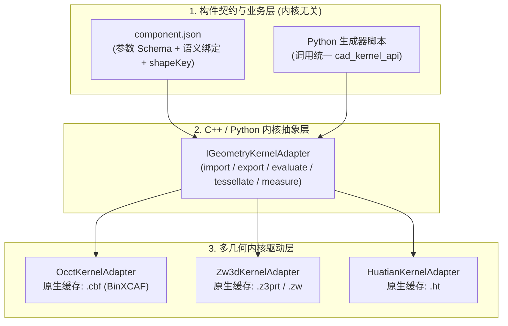

# RCIF 构件数据格式与工程落地规范 v1.0

- **版本**：1.0.0
- **状态**：研发基线规范（Baseline Specification）
- **日期**：2026-10-17
- **适用范围**：QtOCCTApp 构件库管理、参数化建模服务（`scripts-service`）、核心数据模型（`core-data-model`）及工程包（`.rde`）

---

## 1. 规范定位与核心架构原则

### 1.1 格式家族定义

本规范通过职责分离解决“参数化可变性”、“原生几何高性能加载”与“跨内核/跨格式兼容”之间的矛盾，明确定义三类文件载体：

| 扩展名 | 名称 | 容器类型 | 核心职责与定位 |
| :--- | :--- | :--- | :--- |
| **`.rcif`** | **构件定义包**<br>(CBF Component) | ZIP 压缩包 | **构件库中的“类/族模板（Family）”**。存储参数 Schema、规格型号表（Presets）、建模生成器配方、语义绑定契约及默认预览几何。发布后版本不可变。 |
| **`.cbf`** | **原生几何缓存**<br>(OCAF Binary) | `BinXCAF` / `ACTBin` | **运行时高性能“几何快照”**。按内容哈希（`cacheKey`）寻址存储，仅承载 BRep 拓扑、命名子形状（`shapeKey`）和 XCAF 视觉材质，不作为唯一业务主数据。 |
| **`.rde`** | **项目交付包**<br>(Project Package) | ZIP 压缩包 | **工程项目容器**。存储主模型树（构件实例引用 + 参数覆盖 + 空间布置）、图纸文档（2D）及项目引用的去重几何缓存池（`geometry/<cacheKey>.cbf`）。 |

### 1.2 五大核心设计原则

1. **模板与实例彻底解耦**：`.rcif` 构件包定义“参数规则与生成配方”，项目实例仅存储“`componentId` + `revision` + 参数覆盖值（Overrides） + 空间变换（Placement）”，实例生成的 `.cbf` 几何缓存在项目或全局缓存池中，绝不回写污染构件库。
2. **文件极简内聚，禁止双写陷阱**：`.rcif` 包内仅保留 **1 个唯一权威清单 `component.json`**，避免十几个碎片化 JSON 文件带来的 I/O 与校验负担；业务语义统一由 `component.json` 和主文档 `DataModel` 管理，`.cbf` 几何缓存内仅存 `shapeKey` 锚点标签，禁止在几何缓存中镜像双写业务属性树。
3. **语义绑定基于稳定逻辑锚点（`shapeKey`）**：三维实体、参考线（路肩线/坡脚线）、装配端口（Port）均通过生成器显式输出的 `shapeKey` 标识，彻底消除对易变 `TDF_Label`（如 `0:1:4:1`）或拓扑面序号的依赖。
4. **代码级跨内核抽象优于静态 JSON 特征树**：针对复杂土木构件（变截面箱梁、路基边坡、桩基阵列），采用 **Python 统一建模抽象接口（`cad_kernel_api`）** 驱动参数化重建，配合 `IGeometryKernelAdapter` 适配 OCCT、中望（ZW3D）、华天（CrownCAD）等内核，不自研复杂的 JSON 特征历史树。
5. **交换格式按需惰性生成（Lazy Export）**：日常运行仅维护 `.cbf`（精确 BRep）与 `.glb`（显示网格）；高耗时的 `STEP AP242` 仅在跨内核迁移或归档交付时按需生成。

---

## 2. `.rcif` 构件定义包物理结构

每个 `.rcif` 本质是一个标准 Deflate ZIP 归档包，内部固定包含 **3~4 个核心文件**（静态导入构件可附加 `source/` 目录）：

```text
<family_id>_<revision>.rcif (ZIP 容器)
├── component.json          # [必须] 唯一权威清单（内聚身份、参数Schema、型号表、配方、语义绑定）
├── geometry/
│   └── default.cbf         # [必须] 默认参数下的 BinXCAF 原生几何（含命名子形状与材质）
├── display/
│   ├── preview.glb         # [必须] 默认参数下的轻量化网格（用于构件库快速预览或降级显示）
│   └── thumbnail.png       # [可选] 256x256 构件库卡片缩略图
├── source/                 # [可选] 仅当构件来源于外部 IFC / GLB / STEP 时保留原始文件
│   └── original.<ext>
└── checksums.json          # [必须] 包内所有文件的 SHA-256 完整性校验清单
```

> **安全约束**：解压 `.rcif` 时必须校验路径合法性（拒绝包含 `..` 或盘符的绝对路径），且单包解压后总大小默认限制在 `256 MB` 以内，必须在 `checksums.json` 校验通过后方可加载。

---

## 3. `component.json` 权威清单规范

`component.json` 采用 UTF-8 编码，包含 7 个顶级字段：

### 3.1 完整结构示例（以路基边坡 `SubgradeSlope` 为例）

```json
{
  "format": "cbf-component",
  "formatVersion": 1,
  "schemaVersion": "1.0.0",

  "identity": {
    "componentId": "0199f3c2-7d5a-7c3e-9b1a-2f4d6e8a0b11",
    "familyId": "SubgradeSlope",
    "revision": "1.0.0",
    "name": "路基边坡",
    "category": "Subgrade",
    "placementMode": "point",
    "status": "published"
  },

  "environment": {
    "units": { "length": "mm", "angle": "rad", "mass": "kg" },
    "coordinateSystem": {
      "origin": [0.0, 0.0, 0.0],
      "axis": [0.0, 0.0, 1.0],
      "refDirection": [1.0, 0.0, 0.0],
      "handedness": "right"
    },
    "tolerance": { "linear": 0.01, "angular": 0.001 }
  },

  "parameters": {
    "schema": [
      {
        "name": "ModelNumber",
        "label": "标准型号",
        "type": "enum",
        "options": ["CUSTOM", "STD-8M", "STD-12M"],
        "default": "STD-8M",
        "access": "input",
        "group": "Basic"
      },
      {
        "name": "Length",
        "label": "边坡长度",
        "type": "real",
        "unit": "mm",
        "default": 20000.0,
        "min": 1000.0,
        "max": 200000.0,
        "access": "input",
        "group": "Pset_SlopeGeometry"
      },
      {
        "name": "Height",
        "label": "边坡高度",
        "type": "real",
        "unit": "mm",
        "default": 8000.0,
        "min": 100.0,
        "max": 50000.0,
        "access": "inout",
        "group": "Pset_SlopeGeometry"
      },
      {
        "name": "SlopeRatio",
        "label": "坡率(1:m)",
        "type": "real",
        "unit": "1",
        "default": 1.5,
        "min": 0.1,
        "max": 5.0,
        "access": "inout",
        "group": "Pset_SlopeGeometry"
      },
      {
        "name": "Width",
        "label": "坡面水平投影宽",
        "type": "real",
        "unit": "mm",
        "default": 12000.0,
        "access": "output",
        "expr": "Height * SlopeRatio",
        "group": "Pset_SlopeGeometry"
      },
      {
        "name": "StrengthGrade",
        "label": "混凝土强度等级",
        "type": "enum",
        "options": ["C30", "C35", "C40", "C50"],
        "default": "C30",
        "access": "input",
        "group": "Pset_MaterialConcrete"
      }
    ],
    "presets": {
      "STD-8M":  { "Height": 8000.0,  "SlopeRatio": 1.5 },
      "STD-12M": { "Height": 12000.0, "SlopeRatio": 1.75 }
    },
    "constraints": [
      {
        "id": "c_min_length",
        "expr": "Length >= 2000.0",
        "severity": "error",
        "message": "边坡长度不能小于最小示坡线间距 (2000mm)"
      }
    ]
  },

  "recipe": {
    "mode": "parametric",
    "authority": "generator",
    "generator": {
      "id": "SubgradeSlope",
      "version": "1.2.0",
      "engine": "python-cad-api",
      "entry": "generators/subgrade_slope.py",
      "codeHash": "sha256:e3b0c44298fc1c149afbf4c8996fb92427ae41e4649b934ca495991b7852b855"
    },
    "outputs": [
      { "shapeKey": "Body",         "role": "body",      "geomType": "solid", "required": true },
      { "shapeKey": "ShoulderLine", "role": "reference", "geomType": "wire",  "required": true },
      { "shapeKey": "ToeLine",      "role": "reference", "geomType": "wire",  "required": true }
    ]
  },

  "geometry": {
    "defaultCacheKey": "sha256:8f434346648f6b96df89dda901c5176b10a6d83961dd3c1ac88b59b2dc327aa4",
    "capabilities": {
      "exactBrep": true,
      "booleans": true,
      "parametric": true,
      "mesh": true
    },
    "representations": [
      {
        "id": "default-native",
        "role": "authoring",
        "kernelId": "occt",
        "kernelVersion": "8.0.0",
        "format": "cbf-binxcaf",
        "file": "geometry/default.cbf"
      },
      {
        "id": "default-display",
        "role": "display",
        "format": "glb",
        "file": "display/preview.glb"
      }
    ]
  },

  "semantics": {
    "classification": {
      "ifcType": "IfcEarthworksFill",
      "objectType": "SubgradeSlope",
      "functionalTypes": ["路堤边坡", "路堑边坡"]
    },
    "ports": [
      {
        "portId": "StartSection",
        "domain": "alignment",
        "origin": [0.0, 0.0, 0.0],
        "axis": [0.0, 0.0, 1.0],
        "refDirection": [1.0, 0.0, 0.0]
      },
      {
        "portId": "EndSection",
        "domain": "alignment",
        "originExpr": ["Length", 0.0, 0.0],
        "axis": [0.0, 0.0, 1.0],
        "refDirection": [1.0, 0.0, 0.0]
      }
    ],
    "bindings": [
      {
        "id": "bind_height",
        "subject": { "kind": "shape", "ref": "Body" },
        "predicate": { "kind": "property", "ref": "Pset_SlopeGeometry.Height" },
        "value": { "kind": "parameter", "ref": "Height" }
      },
      {
        "id": "bind_volume",
        "subject": { "kind": "shape", "ref": "Body" },
        "predicate": { "kind": "quantity", "ref": "Qto_Body.NetVolume" },
        "value": { "kind": "geometryMeasure", "ref": "Body", "measure": "volume", "unit": "mm3" }
      },
      {
        "id": "bind_shoulder",
        "subject": { "kind": "shape", "ref": "ShoulderLine" },
        "predicate": { "kind": "drawingRole", "ref": "SlopeIndication.ShoulderLine" },
        "value": { "kind": "literal", "value": "ShoulderLine" }
      },
      {
        "id": "bind_toe",
        "subject": { "kind": "shape", "ref": "ToeLine" },
        "predicate": { "kind": "drawingRole", "ref": "SlopeIndication.ToeLine" },
        "value": { "kind": "literal", "value": "ToeLine" }
      }
    ]
  }
}
```

### 3.2 参数求值与型号联动规则（`input` / `inout` / `output`）

为兼容现有 [core-data-model.yaml](file:///D:/QtOCCTApp/core-data-model/schema/core-data-model.yaml) 中的桥墩、托盘、箱梁、承台等构件，参数求值遵循严格的四步优先级流水线：

```text
1. 默认值初始化 (schema.default)
   ↓
2. 规格型号查表覆盖 (若 ModelNumber 命中 presets[ModelNumber]，用预设表覆盖对应参数)
   ↓
3. 实例级参数覆盖 (应用项目实例的 parameterOverrides，仅允许修改 input 与 inout 参数)
   ↓
4. 派生与回写计算
   - 若定义 expr：由客户端表达式引擎在调用生成器前求值；
   - 若无 expr 且 access == "output" / "inout"：由建模服务执行生成器后在 JHB 响应头 args 中返回并回写。
```

### 3.3 空间布置模式（`placementMode`）

构件在 `identity.placementMode` 中声明其在项目中的布置方式：
1. **`point`（点式刚体布置）**：适用于桥墩（`BridgePier`）、承台（`PileCap`）、支座（`Bearing`）等。项目实例通过局部标架 `origin + axis (Z轴) + refDirection (X轴)` 或 $4 \times 4$ 齐次变换矩阵（16 浮点数，列主序）定位，禁止使用有旋转顺序歧义的欧拉角。
2. **`curve`（空间曲线/路线驱动，预留扩展）**：适用于路基边坡（`SubgradeSlope`）、连续箱梁（`Girder`）等线性工程构件，支持向生成器传入三维基准路线曲线（Alignment Curve）。

---

## 4. 原生几何缓存 `.cbf` 内部结构规范

### 4.1 明确 `.cbf` 方言类型

项目中存在两种 `.cbf` 二进制方言，必须在清单与文件头使用层面严格区分：
- **`ACTBin`**：ActiveData 自定义 OCAF 文档格式，仅用于项目主控树（`master.cbf`）和二维图纸文档（`drawings/*.cbf`）。
- **`BinXCAF`**：OCCT 标准 XDE 二进制格式，专门用于**构件几何缓存（`default.cbf` 及 `geometry/<cacheKey>.cbf`）**。

### 4.2 `BinXCAF` 中的命名几何锚点（`shapeKey`）约定

为解决当前 [`ImportAndMergeCbf`](file:///D:/QtOCCTApp/core-data-model/GeometryService.cpp#L338) 只读取 `tempShapes.Value(1)` 单一匿名形状的局限，规范要求生成的构件 `BinXCAF` 文档遵循以下 OCAF 标签树结构：

```text
0:1 (Doc Main)
 └── 0:1:1 (XCAFDoc_ShapeTool Root)
      └── 0:1:1:1 [Component Root Compound]
           │  ├── TDataStd_Name: "<familyId>"
           │  └── TDataStd_AsciiString: "<cacheKey>"
           │
           ├── 0:1:1:1:1 [Sub-Shape: 主体实体]
           │    ├── TNaming_NamedShape: TopoDS_Solid / TopoDS_Shell
           │    ├── TDataStd_Name: "Body"               <-- 对应 recipe.outputs 中的 shapeKey
           │    └── XCAFDoc_VisMaterial / Color         <-- 绑定视觉材质
           │
           ├── 0:1:1:1:2 [Sub-Shape: 路肩特征线]
           │    ├── TNaming_NamedShape: TopoDS_Wire / TopoDS_Edge
           │    └── TDataStd_Name: "ShoulderLine"       <-- 供 2D 示坡线直接按名提取
           │
           └── 0:1:1:1:3 [Sub-Shape: 坡脚特征线]
                ├── TNaming_NamedShape: TopoDS_Wire / TopoDS_Edge
                └── TDataStd_Name: "ToeLine"            <-- 供 2D 示坡线直接按名提取
```

**关键收益**：
- 当三维路基边坡参数修改并重新生成后，[`adSlopeIndication`](file:///D:/QtOCCTApp/core-data-model/schema/core-data-model.yaml#L137-L148) 只需根据 `TargetObjectID` 找到该构件的 `XCAF` 原型 Label，遍历子 Label 查找 `TDataStd_Name == "ShoulderLine"` 和 `"ToeLine"` 的 `TopoDS_Shape`，即可**全自动重算二维示坡线**，无需人工重新拾取边线。

---

## 5. 缓存键（`cacheKey`）计算规范与 JHB 协议升级

### 5.1 确定性 `cacheKey` 计算公式

废除原 [`ComputeParamGeoID`](file:///D:/QtOCCTApp/core-data-model/GeometryService.cpp#L501-L509) 中仅对 `modelType + params` 计算 MD5 的做法，统一改用 **SHA-256**，输入源定义为规范化 JSON 字符串：

$$\text{cacheKey} = \text{SHA256}\left(\text{CanonicalJSON}(\text{CacheKeyPayload})\right)$$

其中 `CacheKeyPayload` 结构如下：
```json
{
  "generatorId": "SubgradeSlope",
  "generatorVersion": "1.2.0",
  "codeHash": "sha256:e3b0c442...",
  "kernelId": "occt",
  "kernelVersion": "8.0.0",
  "units": { "length": "mm", "angle": "rad" },
  "tolerance": { "linear": 0.01, "angular": 0.001 },
  "inputParams": {
    "Height": 8000.0,
    "Length": 20000.0,
    "ModelNumber": "STD-8M",
    "SlopeRatio": 1.5
  }
}
```
**浮点数与键序规范化要求**：
1. 所有 JSON Object 的 Key 必须按字典序升序排列，序列化不含多余空白符。
2. 所有 `real` 浮点数在进入哈希前，按 `%.9g`（消除 `-0.0`，统一科学计数法与尾随零，例如 `8000` 与 `8000.0` 统一规范化）格式化，防止因浮点表示差异导致缓存未命中。
3. 仅纳入影响几何形状的 `input` / `inout` 参数（材质显示颜色或纯管理属性如构件名称不纳入几何 `cacheKey`）。

### 5.2 建模服务 JHB（JSON-Header-Binary）协议 v1.1

客户端（[`GeometryService::CallModelingService`](file:///D:/QtOCCTApp/core-data-model/GeometryService.cpp#L513)）与 `scripts-service` 之间的二进制响应格式保持 `[4字节 uint32 Little-Endian JSON长度][JSON元数据][BinXCAF二进制流]`，扩展 JSON 元数据字段如下：

```json
{
  "status": "ok",
  "cache_key": "sha256:8f434346...",
  "generator_version": "1.2.0",
  "kernel": { "id": "occt", "version": "8.0.0" },
  "args": {
    "Length": 20000.0,
    "Height": 8000.0,
    "SlopeRatio": 1.5,
    "Width": 12000.0
  },
  "outputs": {
    "Body": { "geomType": "solid", "volume": 768000000000.0, "bbox": [0, 0, 0, 20000, 12000, 8000] },
    "ShoulderLine": { "geomType": "wire", "length": 20000.0 },
    "ToeLine": { "geomType": "wire", "length": 20000.0 }
  },
  "anchors": {
    "StartSection": { "origin": [0, 0, 0], "axis": [0, 0, 1], "refDirection": [1, 0, 0] },
    "EndSection": { "origin": [20000, 0, 0], "axis": [0, 0, 1], "refDirection": [1, 0, 0] }
  }
}
```

---

## 6. 多源几何（IFC / GLB）与国产几何内核兼容方案

### 6.1 多源几何分级准入机制

不同来源的构件通过 `recipe.mode` 和 `geometry.capabilities` 声明其能力边界，系统根据能力等级严格控制可执行的操作：

| 来源模式 (`recipe.mode`) | 权威数据 (`authority`) | `exactBrep` | `parametric` | 处理策略与降级规则 |
| :--- | :--- | :---: | :---: | :--- |
| **`parametric`** | `generator` | `true` | `true` | 标准参数化构件，支持变参重建、精确布尔、工程量计算及 2D 特征线提取。 |
| **`native-brep`** | `geometry/default.cbf` | `true` | `false` | 手工建模或 STEP 导入的静态 BRep，支持精确布尔与工程量测量，不支持参数驱动变形。 |
| **`imported-ifc`** | `source/original.ifc` | `true` | `false` | 导入时通过 IfcOpenShell 提取 `IfcProduct` 转为 `default.cbf`，并在 `component.json` 中记录 `GlobalId -> shapeKey` 映射。 |
| **`mesh-only`** | `display/preview.glb` | `false` | `false` | **仅网格构件**（如扫描环境、装饰件）。仅用于视口渲染、碰撞包围盒检测；**禁止参与 BRep 布尔运算与精确体积计算**。 |

> **针对静态导入几何的子形状选择器（Selector）补充规范**：
> 若静态构件（如 IFC/STEP）未能在生成期命名子形状，允许在 `bindings` 中使用基于**归一化包围盒坐标（Normalized BBox `[0.0, 1.0]`）**的动态选择器（如查找法向为 `+Z` 且质心高度位于 `bbox.z > 0.95` 的唯一顶面），**严禁使用写死的绝对毫米坐标**。

### 6.2 面向中望（ZW3D）、华天（CrownCAD）等国产内核的适配架构

为了避免将系统锁死在 OCCT 的 `TopoDS_Shape` 和 `.cbf` 上，采用**“两端解耦”**策略：



1. **C++ 业务层隔离**：上层业务代码（除 `KernelAdapter` 内部外）逐步剥离直接持有的 `TopoDS_Shape` 与 `TDF_Label`，改用逻辑句柄 `(cacheKey, shapeKey)` 访问几何与测量数据。
2. **跨内核切换回退链**：当工程配置的几何内核从 `occt` 切换为 `zw3d` 时：
   - **优先**：如果是 `parametric` 构件，直接由 `zw3d` 后端执行生成器脚本，产出原生缓存 `cache/<cacheKey>.zw`；
   - **次选**：如果是静态 BRep 构件（`native-brep` / `imported-ifc`），由原内核按需导出 `STEP AP242` 中性文件，再由目标内核导入并保存为目标内核的原生缓存，同时校验体积与包围盒偏差（容差 $\le 0.1\%$）。

---

## 7. 现有代码库落地改造指南（研发实施清单）

结合当前工程代码，分三个阶段平滑演进：

### 阶段一：修复现有基础缺陷，打通 `shapeKey` 闭环（P0，近期立即执行）

1. **修复参数回写精度丢失**（[GeometryService.cpp](file:///D:/QtOCCTApp/core-data-model/GeometryService.cpp#L638-L645)）：
   - 将 `WriteBackParams` 中的 `std::to_string(val.get<double>())` 替换为无损浮点格式化（如 `char buf[64]; std::snprintf(buf, sizeof(buf), "%.15g", val.get<double>());`），消除大尺寸坐标（如 `20000.0`）或小坡率被截断的问题。
2. **升级 `ComputeParamGeoID` 为 SHA-256 并规范化浮点数**（[GeometryService.cpp](file:///D:/QtOCCTApp/core-data-model/GeometryService.cpp#L501-L509)）：
   - 引入 SHA-256 替代 MD5，并在哈希输入中加入 `generatorVersion` 和单位标识。
3. **支持多命名子形状（`shapeKey`）合并与提取**（[GeometryService.cpp](file:///D:/QtOCCTApp/core-data-model/GeometryService.cpp#L300-L381)）：
   - 改造 `scripts-service` 的边坡等生成脚本，在输出 `BinXCAF` 时将 `Body`、`ShoulderLine`、`ToeLine` 作为带 `TDataStd_Name` 的子 Label 挂载到根 Compound 下。
   - 在 `GeometryService` 中新增辅助接口 `GetSubShapeByKey(const std::string& paramGeoId, const std::string& shapeKey)`，供二维图纸中的 [`adSlopeIndication`](file:///D:/QtOCCTApp/core-data-model/schema/core-data-model.yaml#L137-L148) 直接提取 `ShoulderLine` 和 `ToeLine`。
4. **文件保存原子化保护**（`ProjectManager.cpp` / `ProjectPackage.cpp`）：
   - 所有 `.cbf` 和 `.rde` 保存操作一律先写入同目录 `<filename>.tmp`，流刷新成功后再调用 `std::filesystem::rename` 原子覆盖目标文件。

### 阶段二：落地 `.rcif` 构件定义包与规格型号表（P1，中期迭代）

1. **实现 `ComponentPackageReader / Writer`**：
   - 支持打包和读取符合第 2、3 节规范的 `.rcif` 文件（内含 `component.json` + `geometry/default.cbf` + `display/preview.glb` + `checksums.json`）。
2. **打通 `ModelNumber` 预设型号查表（`presets`）**：
   - 在 [`GeometryService::ExtractGeoParams`](file:///D:/QtOCCTApp/core-data-model/GeometryService.cpp#L430-L498) 中，当检测到 `ModelNumber` 变更时，先从 `component.json` 的 `presets` 加载标准尺寸，再叠加用户的 `inout` 覆盖值。
3. **补齐工程包 `manifest.json` 元数据**：
   - 在 `ProjectPackage.cpp` 中填实 `schemaVersion`、`coordinateSystem`、每个子文档的 `payloadKind`（`ACTBin` 或 `BinXCAF`）以及文件级 SHA-256 列表。

### 阶段三：内核抽象层与构件库索引服务（P2，长期演进）

1. **提取 `IGeometryKernelAdapter` 接口**：將 `GeometryService` 中的 OCCT / XCAF 细节下沉至 `OcctKernelAdapter`，为后续接入国产内核预留标准插件槽位。
2. **构件库 SQLite 检索目录（`catalog.sqlite`）**：扫描本地或服务端 `.rcif` 构件包的 `component.json`，建立按分类（`category`）、功能类型、规格型号的毫秒级索引库。
