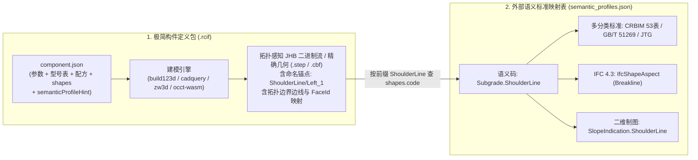
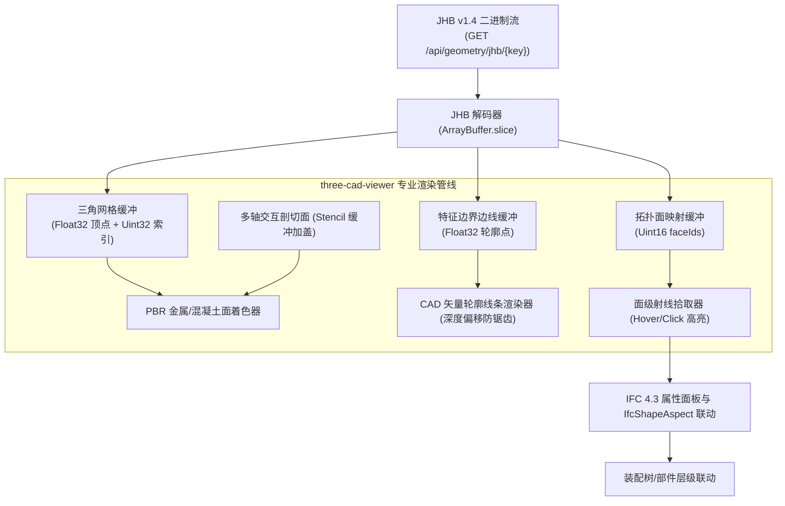

# RCIF 构件数据格式与工程落地规范 v1.4（专业 Code-CAD 工具链与拓扑感知交互增强版）

- **版本**：1.4 (Professional Code-CAD Toolchain & Topological Tessellation Baseline)
- **状态**：正式标准基线（Approved Specification Baseline）
- **日期**：2026-10-19
- **前序版本**：[v1.0](file:///D:/QtOCCTApp/docs/rcif_component_format_spec_v1.0.md) | [v1.1](file:///D:/QtOCCTApp/docs/rcif_component_format_spec_v1.1.md) | [v1.2](file:///D:/QtOCCTApp/docs/rcif_component_format_spec_v1.2.md) | [v1.3](file:///D:/QtOCCTApp/docs/rcif_component_format_spec_v1.3.md) | [v1.3.1](file:///D:/QtOCCTApp/docs/rcif_component_format_spec_v1.3.1.md) | [v1.3.2](file:///D:/QtOCCTApp/docs/rcif_component_format_spec_v1.3.2.md)
- **设计借鉴**：融合 **Autodesk Civil 3D (`.pkt` 点/线/面语义编码 `Code Set`)**、**Archicad GDL (`.gsm` 脚本逻辑内聚)**、**Autodesk Revit (`Subcategory` + 外部 `IFC Mapping Table` + `Type Catalog`)**、**Pixar OpenUSD (按需叠加 Schema)**，以及新一代开源 Code-CAD 标杆 **build123d / OCP CAD Viewer (`three-cad-viewer` + `ocp-tessellate` 拓扑离散与 CAD 级交互管线)**。

---

## 0. v1.4 架构演进与设计核心说明

本规范在 v1.3.2（极简构件模板 + 外部语义映射架构）的基础上，深度吸收了工业界成熟标准与最新 Code-CAD 研发实践。针对既往版本在“构件脚本本地开发调试体验割裂”以及“Web 预览呈现粘连泥巴感、缺少 CAD 级特征黑边与拓扑交互”的痛点，v1.4 完成了三大继承与四大关键增强。

### 0.1 延续三大减法架构护栏（G1~G4 宪法基线）
1. **数据中立与标准解耦（护栏 G1）**：构件包（`.rcif`）仅包含几何槽位与中立语义编码（`code`），行业分类标准（CRBIM/53表/JTG/GB/T 51269）与 IFC 4.3 实体/部件映射统一由系统外部的《语义标准映射表》（`semantic_profiles.json`）动态驱动，实现“标准升级而构件资产零改动”。
2. **计算内聚，废除前端公式轮子（护栏 G2）**：派生计算、边界校验与端口姿态计算完全内聚在建模脚本与服务内部，清单 `component.json` 保持极简静态结构，严禁在前端或元数据中堆砌动态表达式解释器。
3. **服务端权威算键与确定性缓存防御（护栏 G3）**：服务端作为 `cacheKey` 计算的唯一权威源，严格禁止客户端篡改缓存键。标准规格入库预烘焙，变参计算基于 Single-flight 互斥锁去重，$O(1)$ 极速响应。
4. **轻量实用，拒绝过度设计（护栏 G4）**：坚持极简微服务与标准数据流，杜绝非必要的重型中间件。

### 0.2 基于 build123d / OCP CAD Viewer 调研成果的四大核心增强（v1.4 新增）

1. **官方标准 Code-CAD 研制工具链（Authoring Toolchain Suite）**：
   - 彻底淘汰陈旧、易崩溃的独立 Qt 界面脚本编辑器，正式确立 **VS Code + OCP CAD Viewer (`vscode-ocp-cad-viewer`) + `ocp-vscode` + `build123d` / `cadquery`** 为 RCIF 官方推荐的参数化构件开发与调试环境；
   - 规范了基于 `show()` 的断点单步调试、实时 3D 热重载、以及三维视口中鼠标点击面/边反查代码选择器的辅助建模工作流。
2. **拓扑感知 JHB 原生二进制流（Topology-aware JHB Protocol v1.4）**：
   - 借鉴 `ocp-tessellate` 的离散数据结构，升级 JHB 二进制帧格式：
     * **特征线分流打包（Crisp Feature Edges）**：在输出三角网格（`triangles`）的同时，提取 OpenCASCADE TopoDS 真实 B-Rep 边界特征折线（`edges`），Web 端叠加渲染出高清晰度的专业 CAD 矢量轮廓，彻底消除三维“泥巴感”；
     * **拓扑面映射流（`faceIds` Mapping）**：每个三角面片附带其所属的原始 B-Rep 面序号（Face Index），使得 Web 端和桌面端能够实现“鼠标悬停高亮具体面”、“点击面拾取并联动属性面板与 `IfcShapeAspect`”；
     * **绝对容差离散保护**：规避相对容差缩放导致的弦高失真，锁死绝对线性容差与角度容差，并执行高斯散度网格体积双向自检。
3. **Web 3D 专业 CAD 级交互基线（对标 `three-cad-viewer` 交互能力）**：
   - 确立 B/S 构件库 Web 端必须具备的 4 项交互基线：
     * **CAD 级面着色与黑白轮廓复合渲染**；
     * **动态多轴截面剖切加盖（Clipping Planes with Capping）**，支持实时切开实体检视箱梁、空心墩内部结构；
     * **装配体树层级控制（Assembly Hierarchy & Tree View）**，支持子部件独立高亮与显隐控制；
     * **空间三维测距工具（Measurement Tools）**，支持两点间距、边长与圆弧半径核验。
4. **建模引擎支持现代化（`build123d` + `cadquery` 双引擎一等公民）**：
   - 完善 `recipe.engine` 对 `build123d`（下一代 Python Code-CAD 库）与 `cadquery` 的同等支持，并规范发布包中对开发调试代码的清理与保护机制。

---

# 第一部分：通用构件数据格式标准正文（Normative Specification）

## 1. 核心架构：构件定义包与外部语义映射表双层解耦



### 1.1 文件与容器家族定义

| 载体名称 | 扩展名 / 格式 | 定位与职责 |
| :--- | :--- | :--- |
| **构件定义包** | **`.rcif`** (ZIP) | **构件库中的“族模板”**。文件名为 `<familyId>_<revision>.rcif`（同一构件库内 `familyId` 唯一且满足 `^[A-Za-z0-9_-]+$`）。内含极简清单 `component.json`、预览网格 `display/preview.glb`、可选预烘焙几何 `geometry/default.*` 及校验清单 `checksums.json`。 |
| **外部语义标准映射表** | **`semantic_profiles.json`** | **宿主系统/项目级公共配置（Code Set Style）**。定义各语义码（`code`）到国标/行标分类编码、IFC 4.3 实体与算量集、二维制图角色及标准物理材质库的映射规则。 |
| **几何缓存制品** | **`.cbf` / `.step` / `.glb` / `.jhb`** | **运行时按 `<cacheKey>` 寻址的几何快照**。存储精确 BRep 或拓扑感知网格帧，并在子形状上携带 `<shapeKey>[/<instanceTag>]` 命名锚点。 |
| **项目交付包** | **`.rde`** (ZIP) | **工程项目容器**。存储主模型树（实例引用 + 型号选择/参数覆盖 + 空间布置）、当前项目绑定的 `semantic_profiles.json` 快照、二维工程图纸及去重几何缓存池（`geometry/<cacheKey>.*`）。 |

---

## 2. `.rcif` 构件定义包物理结构

每个 `.rcif` 为标准 Deflate ZIP 归档包（UTF-8 文件名编码），内部结构极简固定：

```text
<familyId>_<revision>.rcif (ZIP 容器)
├── component.json          # [必须] 极简权威清单（身份、参数表、规格型号、建模配方、命名几何槽位）
├── geometry/               # [可选] 默认参数下的预烘焙几何制品（支持多格式并存）
│   ├── default.cbf         #        OCCT BinXCAF 原生精确几何（与 defaultCacheKey 严格同源）
│   ├── default.step        #        STEP AP242 跨内核标准精确几何
│   ├── default.jhb         #        JHB v1.4 拓扑感知预烘焙无头二进制流 (含矢量边线与 FaceIds)
│   └── default.glb         #        仅当 sourceMode == "mesh-only" 时作为权威工程网格
├── display/                # [必须] 构件库预览与二维制图图例
│   ├── preview.glb         # [必须] 构件库卡片轻量预览网格（LOD 展示用途）
│   ├── preview.svg         # [推荐] OCCT HLR 消隐矢量投影图 (工程白底黑线，Z轴向上)
│   └── thumbnail.png       # [可选] 256x256 构件库卡片缩略图
├── generators/             # [可选] 仅当内嵌脚本或 WASM 模块时存在
│   └── generator.py        #        build123d 或 CadQuery 参数化几何生成主脚本
└── checksums.json          # [必须] 包内除自身外所有文件的 SHA-256 校验清单
```

> **完整性与五道前置安全门禁约束**：
> 1. **解压安全与配额守门员**：单包限制压缩比 $\le 100$，解压后体积 $\le 200\text{MB}$，文件数 $\le 500$，绝对拒绝任何含 `..`、前导 `/`、`\`、盘符 `:` 或符号链接的条目；
> 2. **完整性校验**：`checksums.json` 必须覆盖包内除自身外的全部条目，严禁存在未登记的额外文件；
> 3. **脚本真实性与代码验真**：通过 Python AST 语法树扫描，禁止 `eval`, `exec`, `os.system`, `subprocess`, 动态网络请求等高危代码；
> 4. **Schema 结构化验证**：`component.json` 必须严格符合规范声明的 JSON Schema；
> 5. **几何有效性自检**：调用 `BRepCheck_Analyzer` 检查几何封闭流形，散度定理校验网格体积与精确 B-Rep 体积偏差 $< 1.0\%$。

---

## 3. 极简 `component.json` 规范

### 3.1 完整示例（以桥梁圆端形桥墩 `PierBody` 为例）

```json
{
  "format": "cbf-component",
  "schemaVersion": "1.4.0",

  "identity": {
    "componentId": "0199f3c2-7d5a-7c3e-9b1a-2f4d6e8a0b12",
    "familyId": "PierBody",
    "revision": "1.0.0",
    "name": "实体圆端形桥墩",
    "category": "BridgeSubstructure",
    "semanticCode": "Bridge.Pier.Body",
    "semanticProfileHint": "Railway-CRBIM-IFC4X3@1.4",
    "sourceMode": "parametric",
    "placement": {
      "modes": ["point"],
      "orientation": "azimuth"
    }
  },

  "environment": {
    "units": { "length": "mm", "angle": "rad" },
    "tolerance": { "linear": 0.01, "angular": 0.001 }
  },

  "parameters": {
    "schema": [
      { "name": "ModelNumber",   "label": "标准型号",       "type": "enum",    "default": "STD-PIER-12M", "options": ["CUSTOM", "STD-PIER-8M", "STD-PIER-12M", "STD-PIER-16M"] },
      { "name": "TopWidth",      "label": "墩顶顺桥向宽度", "type": "real",    "default": 2400.0,  "unit": "mm", "min": 1000.0, "max": 10000.0 },
      { "name": "TopLength",     "label": "墩顶横桥向长度", "type": "real",    "default": 6400.0,  "unit": "mm", "min": 2000.0, "max": 20000.0 },
      { "name": "PierHeight",    "label": "墩身总高度",     "type": "real",    "default": 12000.0, "unit": "mm", "min": 2000.0, "max": 60000.0, "access": "inout" },
      { "name": "Slope",         "label": "侧面坡度(n:1)",  "type": "real",    "default": 35.0,    "unit": "1",  "min": 10.0,   "max": 100.0 },
      { "name": "CrossSlope",    "label": "墩顶横坡率(%)",  "type": "real",    "default": 2.0,     "unit": "%",  "min": -10.0,  "max": 10.0 },
      { "name": "NetVolume",     "label": "墩身体积",       "type": "real",    "default": 194.52,  "unit": "m3", "access": "out" },
      { "name": "StrengthGrade", "label": "混凝土强度等级", "type": "enum",    "default": "C35",    "options": ["C30", "C35", "C40", "C50"] }
    ],
    "presets": {
      "STD-PIER-8M": {
        "PierHeight": 8000.0,
        "TopWidth": 2200.0,
        "TopLength": 6000.0
      },
      "STD-PIER-12M": {
        "PierHeight": 12000.0,
        "TopWidth": 2400.0,
        "TopLength": 6400.0
      },
      "STD-PIER-16M": {
        "PierHeight": 16000.0,
        "TopWidth": 2600.0,
        "TopLength": 7000.0
      }
    }
  },

  "geometry": {
    "exactBrep": true,
    "defaultFormat": "cbf-binxcaf",
    "defaultFile": "geometry/default.cbf",
    "defaultCacheKey": "a4d3e8712f5a6b7c8d9e0f1a2b3c4d5e6f7a8b9c0d1e2f3a4b5c6d7e8f9a0b1c"
  },

  "recipe": {
    "engine": "build123d",
    "source": "generators/generator.py",
    "entry": "build_pier",
    "version": "1.4.0",
    "digest": "e3b0c44298fc1c149afbf4c8996fb92427ae41e4649b934ca495991b7852b855",
    "inputs": ["TopWidth", "TopLength", "PierHeight", "Slope", "CrossSlope"]
  },

  "shapes": {
    "PierBodySolid": {
      "label": "墩身实体",
      "code": "Bridge.Pier.BodySolid",
      "geomType": "solid"
    },
    "TopBearingFace": {
      "label": "墩顶支撑垫石安装面",
      "code": "Bridge.Pier.TopFace",
      "geomType": "face"
    },
    "PierContourWire": {
      "label": "墩底截面轮廓边界线",
      "code": "Bridge.Pier.BottomContour",
      "geomType": "wire"
    }
  },

  "ports": {
    "PierTopCenter": {
      "label": "墩顶中心控制点",
      "origin": [0.0, 0.0, 12000.0],
      "axis": [0.0, 0.0, 1.0],
      "refDirection": [1.0, 0.0, 0.0]
    },
    "PierBaseCenter": {
      "label": "承台顶面接合点",
      "origin": [0.0, 0.0, 0.0],
      "axis": [0.0, 0.0, -1.0],
      "refDirection": [1.0, 0.0, 0.0]
    }
  }
}
```

### 3.2 建模引擎与运行时环境枚举表（`recipe.engine`）

| `recipe.engine` 明确枚举值 | 具体含义（建模框架 + 底层几何内核） | 对应脚本规范与标准运行时 |
| :--- | :--- | :--- |
| **`"build123d"`** | **build123d 建模引擎**（推荐现代主力，基于 OCCT） | Python 3.10+ 脚本 (`from build123d import *`) |
| **`"cadquery"`** | **CadQuery 建模引擎**（成熟稳定主力，基于 OCCT） | Python 3.10+ 脚本 (`import cadquery as cq`) |
| **`"pythonocc"`** | **pythonOCC 底层引擎**（OpenCASCADE 直接 Python 绑定） | Python 脚本 (`from OCC.Core...`) |
| **`"occt-wasm"`** | **OCCT 原生 C++ 编译的 WebAssembly 插件** | 浏览器端/无头 Node `.wasm` 模块 |
| **`"zw3d"`** | **中望（ZW3D / Overdrive）参数化建模引擎** | 中望参数化特征宏脚本 / 模板 |
| **`"crowncad"`** | **华天（CrownCAD）参数化建模引擎** | 华天云原生几何流定义 |

---

## 4. 命名几何链接与外部《语义标准映射表》规范

### 4.1 `<shapeKey>/<instanceTag>` 机制与多实例自动配对
构件包内通过 `shapes.<Key>` 仅声明一次几何槽位类别。当建模引擎产生多个同类几何个体（如多个垫石面、左右侧边坡）时，采用 `<shapeKey>/<instanceTag>` 形式输出。下游消费时：
1. **取前缀 `<shapeKey>`**：查询 `shapes` 获取中立语义码 `code`，进而查外部 `semantic_profiles.json` 确定分类与 IFC 映射；
2. **取后缀 `<instanceTag>`**：作为区分个体标识，并支持不同图元（如线与面）跨类型关联同名配对。

### 4.2 外部语义标准映射表（`semantic_profiles.json`）示例
```json
{
  "profileId": "Railway-CRBIM-IFC4X3",
  "version": "1.4.0",
  "description": "铁路工程 BIM 分类与编码 53 表 + IFC 4.3 ADD2 语义映射配置",

  "quantityUnits": {
    "length": "m", "area": "m2", "volume": "m3", "roundingDecimals": 3
  },

  "semanticMappings": {
    "Bridge.Pier.Body": {
      "ifcTypeEntity": "IfcBridgePartType",
      "ifcEntity": {
        "class": "IfcBridgePart",
        "predefinedType": "PIER"
      },
      "classifications": [
        { "system": "CRBIM-53", "code": "53-12 20 10 10", "name": "桥墩墩身" },
        { "system": "GB/T-51269", "code": "10-52.12.20", "name": "下部结构" }
      ]
    },
    "Bridge.Pier.TopFace": {
      "ifc": {
        "entity": "IfcShapeAspect",
        "description": "BearingSeat",
        "representation": { "identifier": "Surface", "type": "Surface3D" }
      },
      "quantities": {
        "Qto_BearingSeat.Area": { "type": "IfcQuantityArea", "value": "$measure.area" }
      }
    }
  }
}
```

---

## 5. 确定性缓存键（`cacheKey`）与 JHB 协议 v1.4

### 5.1 确定性 `cacheKey` 计算公式
为保障全平台一致性与单机防击穿：
$$\text{cacheKey} = \text{HexLower}\left(\text{SHA256}\left(\text{DeterministicJSON}(\text{CacheKeyPayload})\right)\right)$$
遵循 5 条规则：键序字典升序、浮点数 `%.12g` 归一化、可选几何以 SHA-256 哈希或 `null` 表达、UTF-8 原始字节直出（严禁 `\uXXXX`）、无多余空格。

### 5.2 拓扑感知 JHB（JSON-Header-Binary）协议 v1.4

JHB v1.4 引入了针对专业 CAD 交互的**拓扑边界特征线与面映射索引分流打包机制**：

```text
JHB v1.4 二进制数据帧结构 (无头零拷贝流):
┌─────────────────────────┬───────────────────────────────┬───────────────────────────────────────────┐
│ 0..3 (4 Bytes)          │ 4 .. 4+N-1 (N Bytes)          │ 4+N .. END (M Bytes)                      │
│ uint32 json_len (小端)  │ UTF-8 JSON Header 元数据字典  │ 紧密集成的连续二进制缓冲流 (Binary Buffers)│
└─────────────────────────┴───────────────────────────────┴───────────────────────────────────────────┘
```

#### （1）JSON Header 元数据字典规范
```json
{
  "protocolVersion": "1.4.0",
  "status": "ok",
  "cache_key": "a4d3e8712f5a6b7c8d9e0f1a2b3c4d5e6f7a8b9c0d1e2f3a4b5c6d7e8f9a0b1c",
  "format": "cbf-jhb",
  "vertexCount": 12480,
  "triangleCount": 24956,
  "edgeLineVertexCount": 4320,
  "buffers": {
    "vertices":     { "offset": 0,      "length": 149760, "type": "float32", "stride": 3 },
    "indices":      { "offset": 149760, "length": 99824,  "type": "uint32",  "stride": 1 },
    "normals":      { "offset": 249584, "length": 149760, "type": "float32", "stride": 3 },
    "edges":        { "offset": 399344, "length": 51840,  "type": "float32", "stride": 3 },
    "faceIds":      { "offset": 451184, "length": 49912,  "type": "uint16",  "stride": 1 }
  },
  "bounds": {
    "min": [-3200.0, -1200.0, 0.0],
    "max": [3200.0, 1200.0, 12000.0]
  },
  "stats": {
    "volumeM3": 194.52,
    "surfaceM2": 312.48,
    "triangles": 24956,
    "edgesCount": 28,
    "facesCount": 14,
    "elapsedMs": 42
  },
  "args": {
    "PierHeight": 12000.0,
    "NetVolume": 194.52
  },
  "anchors": {
    "PierTopCenter":  { "origin": [0.0, 0.0, 12000.0], "axis": [0.0, 0.0, 1.0], "refDirection": [1.0, 0.0, 0.0] },
    "PierBaseCenter": { "origin": [0.0, 0.0, 0.0],     "axis": [0.0, 0.0, -1.0], "refDirection": [1.0, 0.0, 0.0] }
  }
}
```

#### （2）二进制缓冲区各分段职责
1. **`vertices` & `indices` & `normals`**：标准 WebGL 三角网格数据。顶点与法线为 `float32`，索引为 `uint32`，直接映射 `THREE.BufferAttribute`；
2. **`edges`（CAD 特征边界折线）**：由 `ocp-tessellate` 从 TopoDS 真实 B-Rep 边界提取的非平滑折线段集合（两两点对或折线点列），用于在三维视口中叠加 CAD 专业矢量黑边，彻底消除传统网格渲染时的模糊黏连感；
3. **`faceIds`（拓扑面映射数组）**：长度严格等于 `triangleCount`。记录每个三角面片所归属的原始 B-Rep 面编号（`Face Index`），支持鼠标悬停、拾取高亮特定面，并反向索引 `shapes.<Key>` 与 `IfcShapeAspect` 属性。

---

# 第二部分：研制与消费端工程落地指南（Normative Toolchain Profiles）

## 6. 参数化构件本地研制开发规范（VS Code + OCP CAD Viewer）

为保证构件开发者具备极速、直观、低心智负担的建模体验，RCIF v1.4 正式确立以下研制标准：

### 6.1 开发环境搭建基准
- **IDE**：Visual Studio Code (1.85+)；
- **官方插件**：`OCP CAD Viewer`（VS Code 插件市场 ID: `bernhard-42.ocp-cad-viewer`）；
- **Python 虚拟环境依赖**：
  ```bash
  pip install build123d cadquery ocp_vscode
  ```

### 6.2 交互式脚本编写与断点调试规范
构件主脚本（`generator.py`）按以下标准结构组织，兼顾“本地开发热重载”与“服务无头执行”：

```python
"""RCIF 构件参数化建模脚本标准示例 (build123d 模式)"""

from build123d import *

def build_pier(TopWidth=2400.0, TopLength=6400.0, PierHeight=12000.0, Slope=35.0, CrossSlope=2.0):
    # 1. 建模几何计算
    bottom_width = TopWidth + (PierHeight / Slope) * 2
    bottom_length = TopLength + (PierHeight / Slope) * 2

    with BuildPart() as pier:
        # 顶截面与底截面放样
        with BuildSketch(Plane.XY) as s_base:
            SlotOverall(bottom_length, bottom_width)
        with BuildSketch(Plane.XY.offset(PierHeight)) as s_top:
            SlotOverall(TopLength, TopWidth)
        loft = Loft()

    solid = pier.part

    # 2. 构造 RCIF 标准命名槽位输出
    outputs = {
        "PierBodySolid": solid,
        "TopBearingFace": solid.faces().sort_by(Axis.Z)[-1],
        "PierContourWire": solid.wires().sort_by(Axis.Z)[0]
    }
    
    # 回写计算参数
    args = {
        "NetVolume": round(solid.volume / 1e9, 3)
    }

    return {"outputs": outputs, "args": args}

# ----------------- 本地 VS Code 交互式可视化支持 -----------------
if __name__ == "__main__":
    # 本地运行时通过 ocp_vscode 进行 3D 视口联动展示
    try:
        from ocp_vscode import show, set_viewer_config
        set_viewer_config(reset_camera=False)
        res = build_pier()
        show(res["outputs"]["PierBodySolid"], names=["PierBodySolid"])
        print(f"本地建模成功，计算体积: {res['args']['NetVolume']} m3")
    except ImportError:
        pass
```

### 6.3 拾取辅助建模工作流（Feature Selection）
在本地编写涉及倒角（Fillet）、挖槽（Pocket）或垫石定位代码时，开发者可直接在 OCP CAD Viewer 视口中用鼠标点击目标几何面或边：
- 视口自动以高亮轮廓标记选中图元；
- 剪贴板自动复制当前图元的选择语法（如 `faces().filter_by(Axis.Z)[-1]` 或 `edges().filter_by(GeomType.CIRCLE)`），开发者直接粘贴至代码中，避免手动尝试图元索引。

---

## 7. Web 3D 端专业 CAD 级渲染与交互规范（基于 three-cad-viewer）

B/S 构件库管理系统前端在展示 RCIF v1.4 构件时，必须满足以下 4 项专业交互功能基准：



### 7.1 矢量黑边轮廓渲染标准（Crisp Feature Edges）
- 网格表面渲染的同时，将 JHB 中的 `edges` 折线以独立 LineSegments 渲染在模型表面；
- 配置 `polygonOffset: true`、`polygonOffsetFactor: 1.0` 与 `polygonOffsetUnits: 1.0`，杜绝视口旋转时面片与特征线产生 Z-fighting 闪烁；
- 线条颜色采用工程深色系（`#1f2937`），线宽随屏幕 DPI 自适应。

### 7.2 动态多轴交互剖切与自动加盖（Section Clipping & Capping）
- 视口支持沿世界坐标系或构件局部坐标系 X、Y、Z 轴绑定剖切面（Clipping Plane）；
- 剖切截面通过双通道 Stencil Buffer（模板缓冲）进行自动封盖（Cap），截面加盖颜色采用工程剖面填充色（`#d1d5db`），严禁露底空心。

### 7.3 装配树与子部件拓扑交互联动
- 视口左侧/侧边栏必须根据 `shapes` 元数据渲染部件树；
- 鼠标点击树节点，视口自动高亮对应部件，并将相机焦点平滑移动至该部件包围盒中心；
- 鼠标点击视口中的模型面片，通过 `faceIds` 数组反查所属子形状技术键，并在右侧属性栏展开显示其对应的标准分类编码与 `IfcShapeAspect` 属性。

### 7.4 空间三维测距与标注
- 视口内置距离测量工具，利用顶点吸附（Vertex Snapping）量取两点间空间直线距离、水平投影与高差；
- 量取结果与构件 `parameters.schema` 中的真实物理参数提供偏差核对提示。

---

## 附录 A. 宿主系统（QtOCCTApp）落地改造路线图更新

### 阶段一：打通 JHB v1.4 拓扑感知二进制编解码（P0，已完成/进行中）
1. 升级 `jhb_codec.py`，支持 `edges` 提取与 `faceIds` 索引打包；
2. 几何服务生成 STL/BRep 后，同步产出带特征线和面编号的 `.jhb` 产物。

### 阶段二：构件研制脚手架与打包工具集成（P1，当前版本）
1. 发布 `rcif_packager.py`，提供一键将 VS Code 调试完备的 `generator.py` 封装为 `.rcif` 归档包的能力；
2. 前置 5 道安全门禁自动拦截未受保护的 `show()` 语句与高危网络/系统注入调用。

### 阶段三：Web 门户前端换装 `three-cad-viewer` 核心（P1）
1. 升级 Web 前端渲染模块，用 CAD 级面+边复合渲染替换原 STL 单一灰模；
2. 集成滑块交互剖切面与空间三维测距面板。
