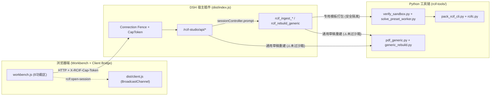

# 构件工作台与智能助手代码审核报告

- **被审对象**：
  - 构件工作台前端：`dsh-rcif/workbench/index.html`、`dsh-rcif/workbench/workbench.js`、`dsh-rcif/workbench/workbench.css`
  - 智能助手宿主与客户端插件：`dsh-rcif/dist/index.js`、`dsh-rcif/dist/client.js`、`dsh-rcif/dist/lib/package.js`、`dsh-rcif/dist/lib/ingest.js`、`dsh-rcif/dist/lib/zip.js`
  - Python 构件工具链与调试后端：`rcif-tools/generic_rebuild.py`、`rcif-tools/pdf_generic.py`、`rcif-tools/pdf2rcif.py`、`rcif-tools/verify_sandbox.py`、`rcif-tools/solve_preset_worker.py`、`rcif-tools/workbench_server.py`
- **审核时间**：2026-10-28 19:10 +08:00
- **总体裁决**：**CONDITIONAL PASS（条件通过，需修复 1 项 BLOCKER 与 4 项 MAJOR）**
- **统计汇总**：BLOCKER = **1**，MAJOR = **4**，MINOR = **6**

> [!CAUTION]
> 2026-10-26 新增的“通用 PDF 草稿在线编辑与重建”链路（`/rcif-studio/api/generic/rebuild` → `rcif-tools/generic_rebuild.py`）直接执行用户/模型传入的 `generatorSource` 源码，未接入 `verify_sandbox.py` 的 Gate-01 AST 静态审查与 `solve_preset_worker.py` 的受限沙箱，构成沙箱绕过（**AUD-01 BLOCKER**），须优先封堵。

---

## 1. 架构与数据流审视



### 六大审查维度评估

| 维度 | 评级 | 现状评估 |
| :--- | :---: | :--- |
| ① 安全与沙箱隔离 | ⚠️ 需整改 | 专用族编译门禁（Gate 1~6 + PEP 578 + C++ 导出打桩）严密；但新增的 `generic_rebuild.py` 未复用该沙箱，直接 `exec_module` 执行外部传入源码。 |
| ② RCIF v1.4.2 契约一致性 | ⚠️ 需整改 | `rcifc.py` 标准向量与确定性打包合格；但 `pdf_generic.py` 与 `generic_rebuild.py` 存在二次打包自指哈希失配、非规范 `cacheKey` 计算及包围盒原点拉偏问题。 |
| ③ 会话与状态持久化 | ⚠️ 需整改 | 工作区/会话树模型清晰；但 `rcif_open_package` 工具仅写内存 Map 未落盘 `.rcif/sessions/<id>.json`。 |
| ④ 3D 视口与交互体验 | ⚠️ 需整改 | 已实现本地化 Three.js + GLB 预览、剖切、端点吸附测距；但存在 `shape.key` 与 `shape.node` 映射分裂、后台标签页持续渲染、共享材质高亮污染。 |
| ⑤ 鉴权与长会话稳定性 | ⚠️ 需整改 | `X-RCIF-Cap-Token` 绑定 `(owner, sessionId, origin)` 机制良好；但前端无 15 分钟 TTL 自动续期，长会话操作会静默返回 403。 |
| ⑥ 代码工程化与可维护性 | ℹ️ 建议优化 | `dist/index.js`（2332 行）与 `workbench.js`（2869 行）单文件过大；部分错误提示仍残留旧端口 `3080`；仓库内存在测试/备份残留文件。 |

---

## 2. 缺陷清单与定位总表

| 编号 | 级别 | 模块 | 精确位置 | 问题描述 |
| :--- | :---: | :--- | :--- | :--- |
| **AUD-01** | **BLOCKER** | 安全沙箱 | `rcif-tools/generic_rebuild.py:49-87`<br>`dsh-rcif/dist/index.js:1225-1238` | 通用草稿重建接收 `generatorSource` 后直接 `exec_module` 执行，绕过 AST 白名单、受限 `__builtins__` 与 PEP 578 审计钩子。 |
| **AUD-02** | **MAJOR** | 契约/哈希 | `rcif-tools/pdf_generic.py:379-384`<br>`rcif-tools/generic_rebuild.py:215-219` | 二次打包悖论：第一次打包算出 `pkg_sha` 写入 `component.json` 后再次打包，导致包内 `qa.packageSha256` 永远是旧哈希且与外层包 SHA-256 失配。 |
| **AUD-03** | **MAJOR** | 几何/契约 | `rcif-tools/pdf_generic.py:242-249`<br>`rcif-tools/generic_rebuild.py:119-126` | ① `bounds` 以 `[0.0, 0.0]` 初始化，当构件坐标不含原点时包围盒被拉偏；② `cacheKey` 未调用 `rcifc.compute_cache_key`（违反 §5.1 `DeterministicJSON`）。 |
| **AUD-04** | **MAJOR** | 会话状态 | `dsh-rcif/dist/index.js:2173-2191` | `rcif_open_package` 仅更新内存 `sessionPackages`，未调用 `recordSessionArtifacts` 写入会话 `.json`，切换会话或重启后绑定丢失。 |
| **AUD-05** | **MAJOR** | 3D/部位联动 | `dsh-rcif/workbench/workbench.js:836-858, 1217-1220` | `renderParts` 与 `selectPart` 仅按 `shape.key` 查找 `state.meshParts`，当 `shape.key !== shape.node`（如 `BearingPad/Left` vs `BearingPad_Left`）时显隐勾选与定位失效。 |
| **AUD-06** | **MINOR** | 鉴权体验 | `dsh-rcif/dist/index.js:36`<br>`dsh-rcif/workbench/workbench.js:128-150` | `capToken` TTL 为 15 分钟，前端 `api()` 未在 `403 CAP_TOKEN_INVALID` 时自动重新握手续期，审阅超 15 分钟后提交批注/重建失败。 |
| **AUD-07** | **MINOR** | 3D 渲染 | `dsh-rcif/workbench/workbench.js:366-370, 845-850` | ① 3D 视图未激活时 `requestAnimationFrame` 仍每帧调用 `renderer.render()`；② `selectPart` 直接修改共享材质的 `emissive` 且未兼容材质数组。 |
| **AUD-08** | **MINOR** | 型号预览 | `dsh-rcif/workbench/workbench.js:1287-1295, 2763-2772` | 切换 `#presetSelect` 型号下拉框时，3D 视图仍渲染默认预烘焙 `preview.glb`，缺少“当前 3D 为默认型号预览”的显式状态提示。 |
| **AUD-09** | **MINOR** | 截图预览 | `dsh-rcif/workbench/workbench.js:1834-1837` | 点击截图通过 `window.open()` + `document.write()` 渲染 base64 大图，在严格 CSP 或嵌入式 WebView 下易被拦截。 |
| **AUD-10** | **MINOR** | 配置/文案 | `dsh-rcif/workbench/workbench.js:2587`<br>`rcif-tools/workbench_server.py:611,626` | 错误提示文案硬编码了旧端口 `3080`（实际 DSH 端口为 `3090`，调试后端为 `3088`）。 |
| **AUD-11** | **MINOR** | 工程整洁度 | `dsh-rcif/` & `rcif-tools/` | `dsh-rcif/test/.contract-b7uW8Q`、`dsh-rcif/rcif-tools/out`、`rcif-tools/_backup_*` 滞留仓库；单文件体积过大且缺乏模块拆分。 |

---

## 3. 重点问题深度剖析与修复方案

### 3.1 [AUD-01 / BLOCKER] `generic_rebuild.py` 未经沙箱直接执行生成器代码

- **问题代码**（`rcif-tools/generic_rebuild.py:49-57`）：
  ```python
  def _load_generator(path: str):
      spec = importlib.util.spec_from_file_location(f"generic_gen_{uuid.uuid4().hex[:8]}", path)
      if spec is None or spec.loader is None:
          raise RuntimeError(f"无法加载生成器: {path}")
      module = importlib.util.module_from_spec(spec)
      spec.loader.exec_module(module)
      if not hasattr(module, "build_parts"):
          raise RuntimeError("生成器缺少 build_parts(params) 函数")
      return module
  ```
- **风险分析**：
  工作台的“构建脚本 → 编辑源码并重建”将用户编辑的文本传给 `/rcif-studio/api/generic/rebuild`，Agent 工具 `rcif_rebuild_generic` 也可传入任意 `generatorSource`。由于 `generic_rebuild.py` 在宿主子进程中直接 `exec_module(module)`，未经过 `verify_sandbox.check_gate1_ast` 静态检查，也未注入 `get_safe_builtins_dict()` 与导出阻断桩，恶意或误写的脚本可直接执行系统命令或任意文件读写。
- **修复方案**：
  1. 在 `generic_rebuild.py` 加载生成器前，先调用 `verify_sandbox.check_gate1_ast(generator_path)`，若 `not g1.passed` 则直接抛出 `ValueError` 拒绝执行；
  2. 将生成器的动态求解改为通过受限沙箱环境（注入 `solve_preset_worker.get_safe_builtins_dict()` + `install_export_mocks()`，或通过受限 worker 子进程）获取部件几何，再由外层可信代码统一导出 `default.step` 与 `preview.glb`。

---

### 3.2 [AUD-02 & AUD-03 / MAJOR] 通用草稿二次打包哈希悖论、包围盒原点拉偏与 `cacheKey` 规范

- **修复方案**：
  1. **包围盒计算**：使用 `[float("inf"), float("-inf")]` 初始化，遍历结束后再 `round(val, 3)`；
  2. **`cacheKey` 规范化**：统一调用 `rcifc.compute_cache_key(digest, next_params)` 生成 `defaultCacheKey` 与预设 `cacheKey`；
  3. **消除二次打包**：不在 `component.json` 内部写入自指的 `qa.packageSha256`（由外层返回字典和 `.provenance.json` / `package_api.py` 提供 `packageSha256`），只调用一次 `rcifc.build_rcif_package`。

---

### 3.3 [AUD-04 / MAJOR] `rcif_open_package` 未同步更新会话持久化文件

- **修复方案**：
  在 `dsh-rcif/dist/index.js` 的 `rcif_open_package` 工具 `run` 函数中，调用 `setCurrentPackage` 之后同步调用 `this.recordSessionArtifacts(sessionId, ...)`，确保 `<workspace>/.rcif/sessions/<sessionId>.json` 落盘更新。

---

### 3.4 [AUD-05 / MAJOR] 3D 视口 Mesh 字典与命名部位 `key`/`node` 映射不一致

- **修复方案**：
  - 在 `workbench.js` 中增加通用查找函数 `findMesh(nameOrKey)`，同时匹配 `state.meshParts[nameOrKey]` 以及 `state.shapes` 中对应的 `node`/`key`；
  - 在 `selectPart` 中将选中状态统一归一化为 `shape.key`，并用 `materialsOf(item)` 遍历材质设置 `emissive`（在 GLB 加载时对每个 Mesh 执行材质浅克隆以避免跨部位材质污染）。

---

### 3.5 [AUD-06 / MINOR] Capability Token 自动续期

- **修复方案**：
  在 `workbench.js` 的 `api(path, options)` 与 `uploadSessionFile` 中，当 `response.status === 403` 且返回体 `data?.code === 'CAP_TOKEN_INVALID'` 时，自动调用 `await connectSession(state.sessionId)` 刷新令牌并透明重试一次请求。

---

## 4. 建议整改路线图

| 阶段 | 包含项 | 预期收益 |
| :--- | :--- | :--- |
| **第一阶段（阻断与核心缺陷修复）** | **AUD-01 ~ AUD-05** | 彻底封堵通用草稿重建的沙箱逃逸口，修复二次打包 SHA-256 失配与包围盒偏差，打通 `rcif_open_package` 会话持久化与 3D 命名部位显隐/定位。 |
| **第二阶段（交互稳定性与 3D 优化）** | **AUD-06 ~ AUD-10** | 实现 CapToken 无感续期、非激活 Tab 暂停 WebGL 渲染、独立克隆 Mesh 材质高亮、型号切换预览提示与端口号统一。 |
| **第三阶段（工程化清理与拆分）** | **AUD-11** | 清理仓库测试/备份残留目录并更新 `.gitignore`，后续按模块拆分 `dist/index.js` 与 `workbench.js`。 |
