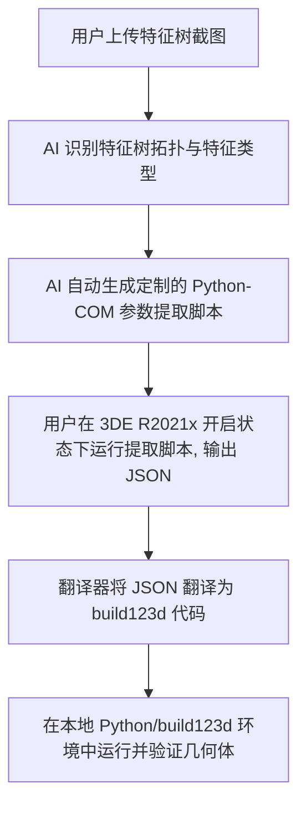

# 基于截图引导的 CATIA 3DEXPERIENCE (R2021x) 特征树导出至 build123d 脚本规划

本方案旨在实现一个自动化工作流：通过用户提供的 **CATIA 3DEXPERIENCE R2021x 特征树截图**，识别零件的建模步骤，然后编写定制的 CATIA Python-COM 提取脚本，获取高精度的特征参数，并最终自动生成等效的 **build123d** Python 参数化建模代码。

---

## 核心技术选型与设计

根据用户偏好与环境配置，我们锁定以下技术方案：
1. **源端环境 (CATIA 3DEXPERIENCE R2021x)**：
   * 由于 R2021x 版本不原生支持内部高级 Python 规则编辑器（R2022x+ 引入），我们将统一采用 **外部 Python-COM 自动化接口** (使用 Python `win32com.client` 或 `pycatia` 库)。
   * 脚本运行在外部，通过 OLE/COM 注册表连接正在运行的 `CATIA.Application` 进程，从而安全地抓取 3DE 活跃编辑器的内部数据。
2. **目标代码库 (build123d)**：
   * 采用现代的 **build123d** 参数化三维 CAD 脚本库作为生成目标。
   * 利用其声明式、基于上下文管理器（如 `BuildPart`、`BuildSketch`）的语法，将 CATIA 的 `PartBody`、`Shapes` 映射为等效的代码块。

---

## 阶段规划与实施步骤

### 第一阶段：视觉输入与特征映射定义
1. **图像分析**：
   * 分析用户上传的 3DEXPERIENCE R2021x 特征规格树（Specification Tree）截图。
   * 确定特征创建的拓扑顺序和具体的特征节点（如 `Pad.1`、`EdgeFillet.2`、`Sketch.1`）。
2. **特征对照设计**：
   * `Sketch` $\rightarrow$ `with BuildSketch(Plane.XY)` 等。
   * `Pad` $\rightarrow$ `Extrude(amount=...)`。
   * `Pocket` $\rightarrow$ `Extrude(amount=..., mode=Mode.SUBTRACT)`。
   * `EdgeFillet` $\rightarrow$ `Fillet(..., radius=...)`。

### 第二阶段：编写定制化 Python-COM 提取脚本（CATIA 2021 端）
1. **生成提取脚本**：
   * AI 生成一个针对截图特化设计的 Python 脚本，通过 `win32com.client.Dispatch("CATIA.Application")` 获取活动的 3D Shape 引用。
2. **参数收集范围**：
   * **草图层**：解析指定草图的参考平面、几何图元（点、线段、圆弧）的 $2D$ 终点与半径坐标，以及尺寸约束值。
   * **特征层**：解析拉伸距离（`FirstLimit.Dimension.Value`）、孔型结构、圆角等数据。
3. **输出中间数据**：
   * 将提取的信息格式化输出为 `features_intermediate.json`。

### 第三阶段：代码生成与翻译（build123d 端）
1. **设计代码生成器**：
   * 编写翻译器脚本 `translate_to_build123d.py`。
   * 遍历 `features_intermediate.json` 中的草图线段与特征属性，套用 build123d 语法模板。
2. **输出 build123d 脚本**：
   * 自动生成标准的 `.py` 脚本，可直接在安装了 `build123d` 的 Python 环境下运行。

### 第四阶段：几何验证与闭环对比
1. **本地运行测试**：
   * 运行生成的 build123d 脚本，生成等效的 3D 几何实体并渲染。
2. **偏差分析**：
   * 比较两者的物理属性（如体积、重心），验证转换正确性。

---

## 用户确认与反馈

> [!IMPORTANT]
> 请您评估本实施计划：
> 1. 您目前倾向于生成 **CadQuery** 还是 **build123d** 的脚本？（通常 build123d 拥有更现代的 API 结构，而 CadQuery 的生态更为成熟）
> 2. 您是否方便上传一个具有代表性的 **3DEXPERIENCE 规格树截图**？收到截图后，我将立即为您定制生成提取脚本。
