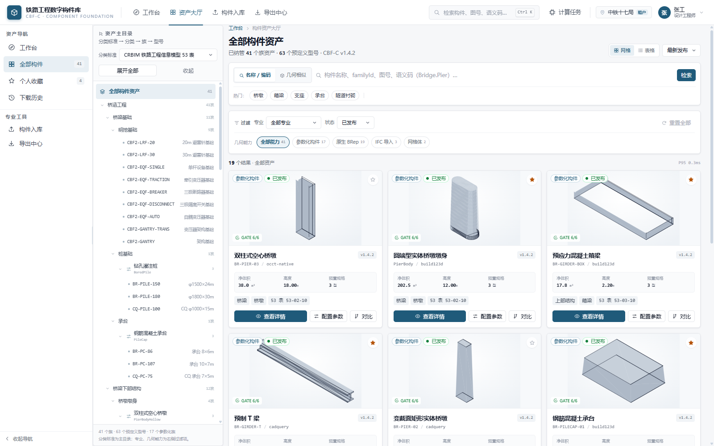
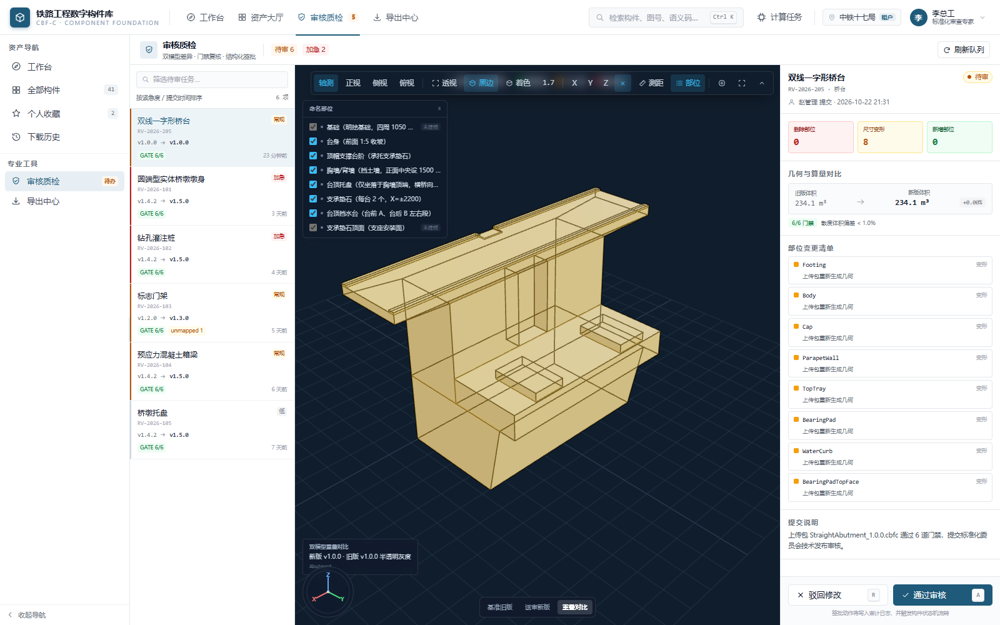

# 铁路工程数字构件库 Web 端

基于 RCIF v1.4.2 / JHB v1.4.3 的构件库管理系统演示实现：Vue 3 + TypeScript + Vite + Three.js，后端为同一仓库内的 Mock API（Vite middleware，dev / preview 共用）。



## 1. 快速启动

```bash
cd D:\QtOCCTApp\rcif-web
npm install
npm run dev
```

打开 **http://127.0.0.1:5178**。演示环境默认自动以设计工程师登录，点击右上角头像可切换角色。

```bash
npm run typecheck
npm test
npm run build
npm run e2e
npm run e2e:roles
npm run e2e:security
npm run shots
```

## 2. 角色化导航

导航统一由 `src/navigation.ts` 维护，顶栏、侧栏、命令面板共用。

| 角色 | 导航 |
| :--- | :--- |
| 设计工程师 | 工作台、资产大厅、构件入库、导出中心、个人收藏、历史 |
| 标准审查专家 | 工作台、资产大厅、审核质检 |
| 资产管理员 | 工作台、资产大厅、族库管理、构件入库、审核质检、语义中枢、监控看板、导出中心 |
| 标准管理员 | 工作台、资产大厅、语义中枢、监控看板、导出中心 |
| 外部合作方 | 工作台、资产大厅、个人收藏 |

页面边界详见 [rcif_web_information_architecture.md](../docs/rcif_web_information_architecture.md)。

## 3. 页面与能力

### 3.1 工作台

- 紧凑检索、角色快捷入口、最近使用/收藏、标准映射摘要。
- 标准映射「查看」直接打开 `/semantics?panel=sandbox&filter=unmapped`，定位未映射项。
- 不设营销 Hero 和重复高频 Chips。

### 3.2 资产大厅

- 分类标准 → 分类 → 族 → 型号主目录。
- 名称/编码检索、专业/状态/几何能力过滤；不提供尺寸区间过滤。
- 网格/表格、收藏、对比、详情入口。
- 几何相似检索作为高级检索，显示相似度徽标。
- 3D 等轴测 SVG 预览，`` 加载，阻断 SVG 内嵌脚本。

### 3.3 构件详情

- 3D 视口、关键技术规格、下载、参数配置入口、IFC 导出。
- 普通设计工程师看到：几何部位、外部语义、二维投影、版本记录。
- 管理员/审查专家额外看到：确定性缓存与 QA、治理快照、cacheKey/JHB 信息。

### 3.4 参数配置器

- Presets 优先，参数滑块，3D 视口，体积/面积/算量，导出。
- 端口定义、缓存键、零拷贝与异步管线细节仅高级角色可见。
- 仅 `parametric` 构件开放在线变参。

### 3.5 构件入库

- 拖入 `.rcif`，计算 SHA-256，执行 6 道门禁检查。
- 门禁摘要、阻断原因、报告下载、提交发布审核。
- 3D 验真和技术诊断默认收起；`?debug=1` 可见演示故障注入。
- 当前门禁是 Mock 演示，不解压真实 ZIP，页面已显式提示。

### 3.6 审核质检

- 待审队列、双模型差异、参数/体积/部位变更、通过/驳回。
- 驳回必须填写结构化意见；签批写入审计并驱动状态机。
- 快捷键 J/K/A/R 保留，但不在顶部占用提示空间。

### 3.7 族库管理

- 资产管理员专属；族与型号 CRUD、模板克隆、参数覆盖、状态管理。
- 发布/送审必须走门禁和审核，不允许直接 PATCH 为 `published`。

### 3.8 构件语义

- 管理员可编辑规则；普通内部用户可由工作台进入只读沙盒。
- 模板、规则表、服务端 Resolver 推演、unmapped 筛选与导出。
- 支持「全部 / 仅未映射」切换。

### 3.9 监控看板

- 4 个 KPI、2 个趋势、失败任务与待复核资产。
- CAS、存储、审计日志收进高级信息。

### 3.10 导出中心 / 收藏 / 历史

- 导出：格式 → 许可 → 下载，支持 `.rcif / .ifc / .glb / .step / .cbf`。
- 收藏与历史保持简单列表，不重复大屏统计。



## 4. 架构

```text
rcif-web/
├─ shared/                  # 前后端共享类型、确定性 JSON/cacheKey
├─ server/                  # Mock API、几何生成、JHB、投影、族库、制品
│  ├─ seed.ts               # 41 个构件种子 + 预定义型号
│  ├─ geometry.ts           # 程序化网格 + 特征边 + SVG/GLB 预览
│  ├─ projection.ts         # 网格 HLR 三视图/轴测
│  ├─ jhb.ts                # JHB v1.4.3 编码
│  ├─ artifacts.ts          # .rcif/.cbf/.jhb/GLB/IFC
│  └─ api.ts                # /api/v1/* Mock 契约
├─ src/
│  ├─ navigation.ts         # 角色导航单一来源
│  ├─ views/                # 页面
│  ├─ components/viewer/    # Three.js 视口
│  ├─ jhb/                  # 双通道解码
│  └─ stores/               # Pinia
├─ cq_script/               # 已入库 CadQuery 源脚本
└─ scripts/                 # API 冒烟 + CDP/安全 E2E
```

## 5. 关键 API

```text
GET    /api/v1/components                 # 检索/分面
GET    /api/v1/components/{id}            # 详情
GET    /api/v1/components/{id}/preview.svg
POST   /api/v1/components/{id}/evaluate   # 200 JHB | 202 jobId
GET    /api/v1/jobs/{id}[/result]
POST   /api/v1/components/upload          # 6 道门禁
POST   /api/v1/uploads/{id}/submit
GET    /api/v1/reviews
POST   /api/v1/reviews/{id}/approve|reject
GET    /api/v1/semantic-profiles
POST   /api/v1/semantic-profiles/preview
GET    /api/v1/analytics/overview
```

### 认证

Token 为 `demo.<userId>.<expiresAt>.<HMAC-SHA256>`，15 分钟有效；支持 Bearer 和预览/投影图的 query token。演示登录仍按 `role` 签发，生产必须替换为企业 SSO。

## 6. 测试

```text
npm run typecheck     通过
npm test              30/30 通过（7 个测试文件）
npm run build         通过
npm run e2e           通过
npm run e2e:roles     通过
npm run e2e:security  11/11 通过
```

覆盖：确定性 JSON/cacheKey、JHB 解码、seed、投影、几何、族库、.rcif 一致性、按 shape 的 JHB 输出、生成脚本转义，以及认证/越权快速验证。

## 7. 当前边界

1. **几何为演示实现**：原始族由 `server/geometry.ts` 程序化放样；构件库2 首批 13 个构件使用 GLB 转换网格。生产应替换为 OCCT/build123d Worker。
2. **门禁为 Mock**：只接收文件元数据并模拟检查，不解压真实 ZIP；页面已标注。
3. **认证为演示**：登录可按 role 签发，URL 可切换演示身份；生产需 SSO。
4. **JHB 生产环境**：当前为 Mock 服务端编码，JHB 帧、边界与三通道解码契约按规范实现。
5. **配置器导出**：当前导出默认型号几何，尚未把当前参数结果写入导出包。
6. **审核几何落地**：审核通过后状态与缓存键更新，但三维网格尚未按 newParams 重建。
7. **数据持久化**：内存态，重启后任务、票据、上传和审核状态恢复初始种子。

更多：

- [代码审核报告](../docs/rcif_web_source_code_review_2026-10-19.md)
- [审核评估与修复记录](../docs/rcif_web_source_code_review_response_2026-10-19.md)
- [角色化信息架构](../docs/rcif_web_information_architecture.md)
- [CQ 脚本入库记录](../docs/cq_script_ingestion.md)
- [构件库2 首批导入](../docs/rcif2_ingestion.md)
